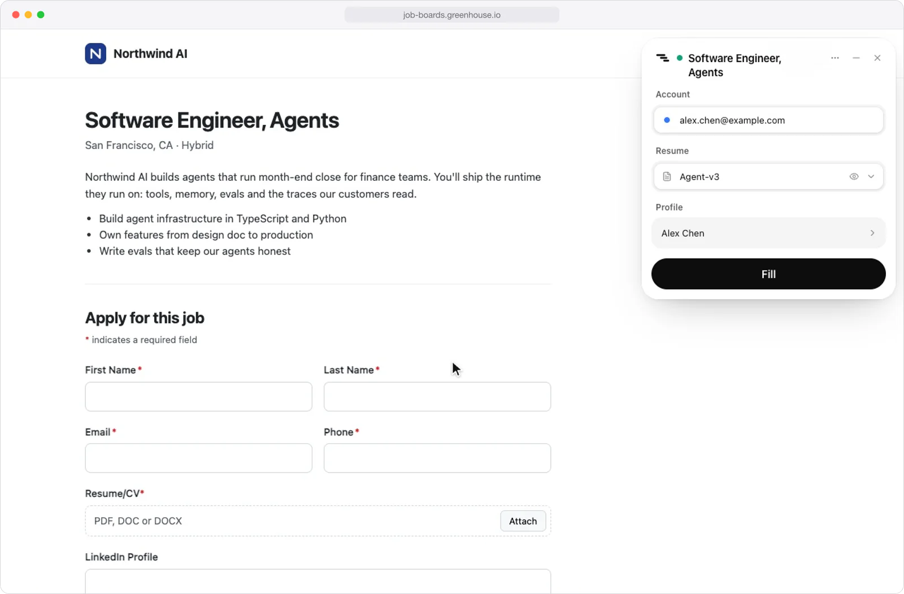
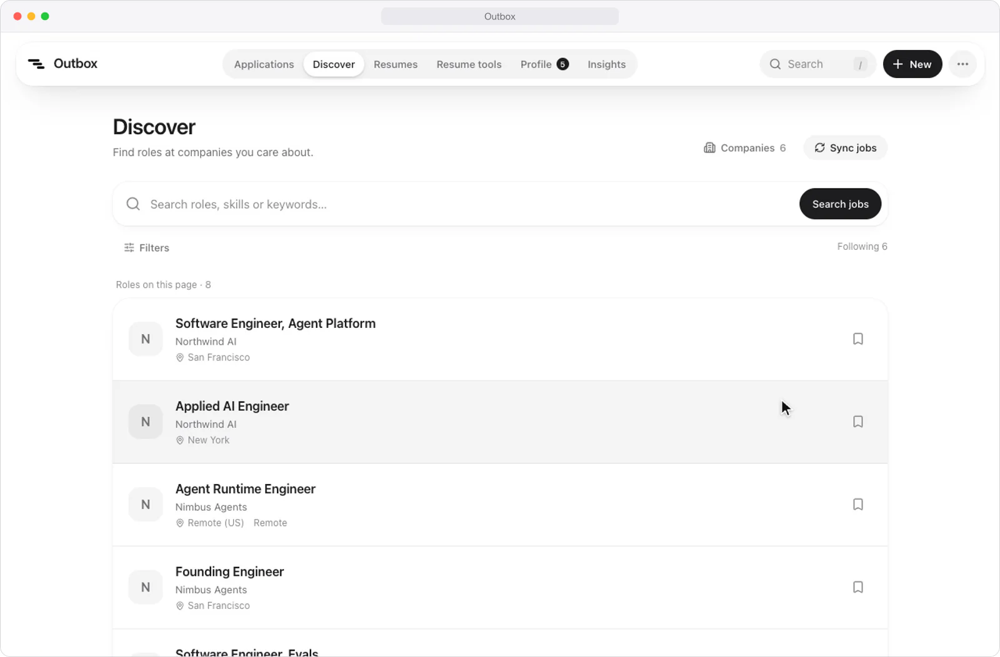

<div align="center">


# Outbox

**Fill job applications from your profile, and keep track of every one you send.**

A job-application tracker with a Chrome extension that fills application forms and logs each submission by
itself, and a NestJS service that gathers open roles from job boards and parses resumes with an LLM.

[](tsconfig.json)
[](package.json)
[](wrangler.jsonc)
[](extension)
[](https://github.com/heyemlee/work-tracker/actions/workflows/ci.yml)

**English** · [简体中文](README.zh-CN.md)

[Highlights](#highlights) · [Architecture](#architecture) · [Tech stack](#tech-stack) · [Features](#features) · [Develop](#develop)

</div>

<p align="center">
  
</p>

<p align="center"><sub>A made-up posting on a stand-in Greenhouse page, filled from a made-up profile.</sub></p>

## Highlights

- **Rules first, Claude for the rest.** A Chrome MV3 extension with adapters for 9 applicant tracking systems
  fills forms by rule (365 of 365 hand-checked answers right on 22 saved pages) and asks Claude for the rest.
- **Measured LLM parsing.** Resumes are parsed by function calling or structured output, every reply must pass a
  strict zod schema, and an eval CLI scores both methods field by field.
- **Job data in PostgreSQL.** A NestJS service syncs job boards in one transaction per company, keeps stored
  postings when a read fails, serves full-text search, and benchmarks indexes, partitions and a Redis cache.
- **One Worker, one contract.** A Cloudflare Worker serves the React app and a Hono API over D1, and one
  `Repository` contract suite runs against both the browser store and D1 in workerd.
- **Tested end to end.** Vitest covers the domain rules, the contract and the extension's adapters; Playwright
  runs the extension on saved pages in Chromium in CI.

## Architecture

<p align="center">
  
</p>

One Worker serves the built app and the API under `/api`, with data in D1. The extension reads the profile and
resume PDFs from that API and logs each submission to it; its AI key stays in the extension. Discover and Resume
tools reach the NestJS service in `backend/` through the dev server, so a production build shows them as
unavailable.

- **Private by default.** Google sign-in for allowlisted emails only. Every query is scoped to the signed-in user,
  request bodies are validated, and cross-site form posts are rejected.
- **Built for D1.** Multi-row writes go out as one atomic batch, split to fit D1's 100 bound parameters per
  statement; deletes are soft, so they can be undone.

## Tech stack

| Layer     | Technology                                                                       | Role                                                                                             |
| --------- | -------------------------------------------------------------------------------- | ------------------------------------------------------------------------------------------------ |
| Web app   | React 19 · TypeScript · Vite · Tailwind CSS v4 · Motion · Radix · TanStack Query | The list, Insights, Discover, Resume tools, profile and first-run guide                          |
| API       | Cloudflare Workers · Hono · zod · Better Auth                                    | One Worker serves the app and `/api`; Google sign-in for allowlisted addresses                   |
| Data      | D1 (SQLite) · Drizzle                                                            | Postings, applications, timelines, the profile and resume PDFs                                   |
| Extension | Chrome Manifest V3 · WXT · React 19 · pdf.js · Anthropic TypeScript SDK          | Fills applications by rule, asks Claude for the rest, logs each submission                       |
| Service   | NestJS · Prisma · PostgreSQL · Redis                                             | [`backend/`](backend): job aggregation and search, resume parsing and evals, database benchmarks |
| Quality   | Vitest · Playwright · ESLint with the React Compiler rules · Prettier            | Domain, contract and adapter tests; the extension end to end in Chromium, in CI                  |

## Features

### Autofill extension

The extension in [`extension/`](extension) fills applications from the profile you keep in Outbox and logs each
submission to it. It never presses Submit: you check every answer first.

- **Rules first.** Adapters for Greenhouse, Lever, Ashby, Workday, Gem, iCIMS, SmartRecruiters, Workable and
  Jobvite drive each form's widgets, with a generic adapter for other forms. Work authorization is answered by
  fixed rules for the job's country, never by a model, and always marked for you to check.
- **Claude for the rest.** Fields the rules can't place go to Claude in one request per form; anything under 0.7
  confidence stays blank. Essay questions get a short draft grounded in the resume and the posting.
- **A match check before filling:** citizenship or clearance requirements, seniority, the company's H-1B
  approvals, and how many of its postings you applied to in the last 30 days. It warns and never blocks.
- **It logs itself.** When the confirmation page loads, the application lands in Outbox with its channel, resume
  version and link, and can be undone.

Rules-only fill accuracy on 22 saved application pages, every expected answer checked by hand:

| System     | Pages | Answers correct | Required fields filled |
| ---------- | ----: | --------------: | ---------------------: |
| Greenhouse |    10 |       172 / 172 |                    87% |
| Lever      |     6 |       115 / 115 |                    79% |
| Ashby      |     6 |         78 / 78 |                    77% |

The blank required fields are essays and questions only the applicant can answer. Workday (behind a sign-in),
iCIMS, SmartRecruiters, Workable and Jobvite are tested on pages modeled on their forms instead. The design is in
[docs/autofill.md](docs/autofill.md).

### Discover, Resume tools and Tracker

<p align="center">
  
</p>

<p align="center"><sub>Fictional companies, roles and resume, in the White theme.</sub></p>

**Discover** gathers the open roles of the companies you follow.

- Pick companies from a catalog, or add any Greenhouse, Lever or Ashby board by its careers URL; the source is
  checked before it's saved.
- Each board's public API is read in full and written to PostgreSQL in one transaction per company. A posting
  that disappears is marked closed and reopens if it returns; a timeout or a malformed reply keeps what's stored.
- Full-text search with location, company and remote filters. A saved role becomes a saved posting in the
  tracker, matched against the postings already there.

**Resume tools** read a resume into your profile.

- A PDF or DOCX of up to 5 MB is read locally in a worker thread; nothing reaches a model until **Parse resume**.
- OpenAI or Anthropic, by function calling or structured output. A refusal, a truncated reply or an unknown field
  fails the zod schema instead of being patched, and an eval CLI scores both methods against reference labels.
- The result opens in your profile as a draft: contact details fill only the blanks, ticked sections replace
  their drafts, skills are merged, and nothing is stored until Save.

**Tracker** keeps every application from saved to offer.

- Each application records the channel and resume version it used and moves Applied → OA → Offer. Rejection is
  a flag, not a stage, so "rejected after the OA" keeps its stage.
- Log one in about five seconds by keyboard, or paste the posting's link; adds and deletes can be undone.
- Insights show the funnel and the OA rate of each resume version and channel. Liquid Glass with real refraction
  in Chromium, English and Chinese, CSV export, and a phone layout.

## Develop

```bash
npm install
cp .dev.vars.example .dev.vars     # set BETTER_AUTH_SECRET to any long random string
npm run db:migrate:local
npm run dev                        # http://127.0.0.1:5180, signed in as a local developer
npm run dev:local                  # sample data in the browser, no backend
npm run ext:build                  # the extension, into extension/.output/chrome-mv3
npm --prefix backend run infra:up  # PostgreSQL for the service behind Discover and Resume tools
npm --prefix backend run dev       # the service, on 127.0.0.1:3100 next to npm run dev
npm run icons                      # the app's and the extension's icons, from src/assets/outbox.svg
```

The service's first-time setup is in [backend/README.md](backend/README.md) (in Chinese); how the app reaches it,
and what stays local, is in [docs/local-tools.md](docs/local-tools.md).

## Test

```bash
npm test                           # domain logic, the repository contract, the extension's rules and adapters
npm run test:ui                    # the main app in Chromium, with the service and models mocked
npm run e2e -w extension           # the extension end to end on saved pages, logging to a mock Outbox
```

CI type-checks, lints, checks formatting, runs the unit tests, builds, and runs the extension end to end. The
Claude free-text eval costs money and runs only on request (`npm run eval -w extension`).

## Deploy

See [docs/deploy.md](docs/deploy.md), which also covers installing the extension. Product and architecture
decisions are in [docs/design.md](docs/design.md).
