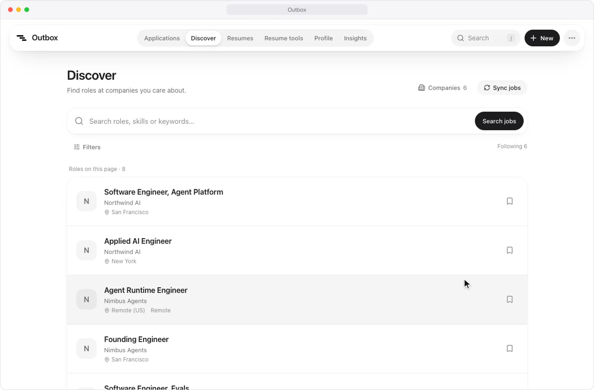
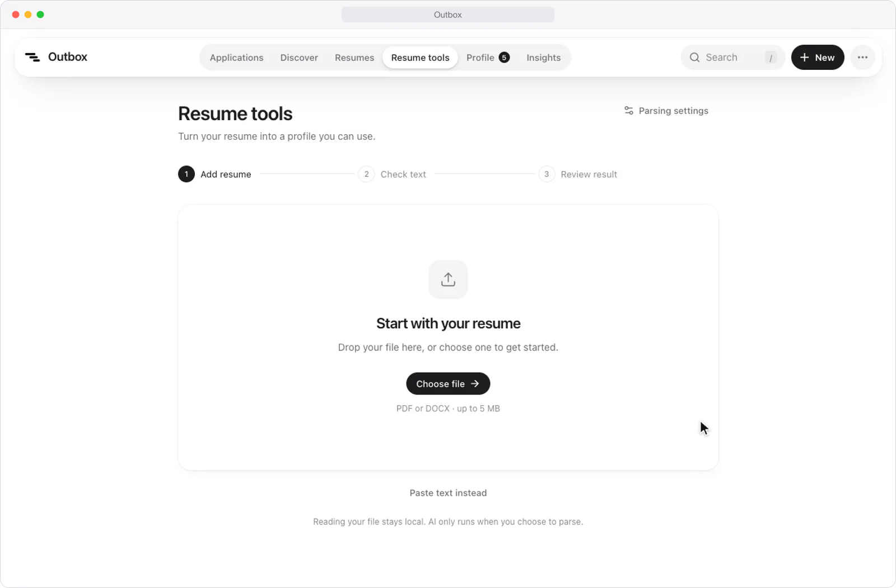

<div align="center">


# Outbox

**Fill job applications from your profile, and keep track of every one you send.**

A job-application tracker with a Chrome extension that fills application forms from your profile and logs each
submission by itself. Logging one by hand takes about five seconds, and Insights show which resume and channel
get you OAs. Behind Discover and Resume tools, a NestJS service gathers the open roles of the companies you follow
from their job boards and parses resumes into your profile with an LLM.

[](tsconfig.json)
[](package.json)
[](wrangler.jsonc)
[](extension)
[](https://github.com/heyemlee/work-tracker/actions/workflows/ci.yml)

**English** · [简体中文](README.zh-CN.md)

[Autofill extension](#autofill-extension) · [Tracker](#tracker) · [Discover and Resume tools](#discover-and-resume-tools) ·
[Architecture](#architecture) · [Tech stack](#tech-stack) · [Develop](#develop)

</div>

<p align="center">
  
</p>

<p align="center"><sub>A made-up posting on a stand-in Greenhouse page, filled from a made-up profile.</sub></p>

## Autofill extension

A Chrome extension in [`extension/`](extension) fills job applications from a profile you keep in Outbox, started
from your resume PDF, then logs each submission to Outbox. It never presses Submit: you check every answer first.

- **Rules first.** Adapters for Greenhouse, Lever, Ashby, Workday, Gem, iCIMS, SmartRecruiters, Workable and
  Jobvite read the form and drive its widgets, any other form with a resume upload and a name or email gets a
  generic one, and a field dictionary answers the questions most forms repeat. Work authorization (sponsorship
  now or later, OPT, export control, clearance) is answered by fixed rules for the job's country, never by a
  model, and is always marked for you to check.
- **Claude for the rest.** Fields the rules can't place go to Claude in one request per form; anything under
  0.7 confidence stays blank. Essay questions get a short draft grounded in the resume and the posting, for you
  to edit.
- **A match check before filling:** citizenship or clearance requirements, seniority, the company's H-1B
  approvals (USCIS, FY2021–2023), and how many of its postings you applied to in the last 30 days. It warns and
  never blocks.
- **It logs itself.** When the confirmation page loads, the application lands in Outbox with its channel, resume
  version and link, and can be undone. On a posting, **Mark as applied** logs it without a form and **Save for
  later** keeps it as a saved job.

Fill accuracy on 22 saved application pages, using rules only (no AI). Every expected answer was checked by
hand:

| System     | Pages | Answers correct | Required fields filled |
| ---------- | ----: | --------------: | ---------------------: |
| Greenhouse |    10 |       172 / 172 |                    87% |
| Lever      |     6 |       115 / 115 |                    79% |
| Ashby      |     6 |         78 / 78 |                    77% |

The required fields left blank are essays and questions only the applicant can answer, such as "Are you
currently a Wealthfront client?". Workday's forms sit behind a sign-in, so its adapter is built from Workday's
`data-automation-id` conventions and tested on a page modeled on them rather than a saved one. The iCIMS,
SmartRecruiters, Workable and Jobvite adapters are tested on small fixtures that keep each form's structure as seen
on public pages, and aren't in the table yet. The design is in [docs/autofill.md](docs/autofill.md).

## Tracker

<p align="center">
  
</p>

<p align="center"><sub>Fictional companies and roles, in the White theme.</sub></p>

- **From saved to offer.** Each application records the channel and resume version it used and moves Applied →
  OA → Offer. Rejection is a flag, not a stage, so "rejected after the OA" keeps its stage. A posting with no
  application yet is simply saved.
- **Logging in about five seconds.** Press `N`, type the company, `Tab` to the title, press `Enter`. Typing a
  company you've applied to before offers its postings. Or paste the posting's link: the company fills itself
  in, and a link you've already tracked opens its posting. Adds and deletes can be undone.
- **A list you can scan.** Grouped by day, 25 postings to a page, with today's count against a daily goal, the
  last 7 days and active OAs, status filters with counts, search (`/`), and a switch to hide rejections. An
  application still at Applied after 30 days reads _No reply_ and fades. Every change lands on the posting's
  timeline.
- **Numbers that say what works.** An Insights page shows the funnel from applied to OA to offer, applications per
  day against the goal, and the OA rate of each resume version and channel, for 7 days, 30 days or everything.
- **Set up in a few minutes.** A first-run guide walks through the email you apply with, your resumes, the
  extension and its key, reading a resume into your profile, and the answers no resume holds. A checklist on the
  home page keeps what's left, until the extension logs your first application.
- **Liquid Glass.** Blur, saturation, and a specular rim in every browser, with real refraction (an SVG
  displacement map) in Chromium. Four looks: White (the default), Light with soft glows, pure-black Dark, or the
  system's. Reduced motion and reduced transparency are honored.
- English and Simplified Chinese, CSV export, and a layout that works on a phone. Passwords are never stored.

## Discover and Resume tools

Two pages of the app sit on a NestJS service in [`backend/`](backend), with its own PostgreSQL database.

### Discover

<p align="center">
  
</p>

- **Roles from the companies you follow.** Pick companies from a catalog, or add any Greenhouse, Lever or Ashby
  board by its careers URL; the service checks the source before it saves it.
- **A sync that keeps what it can't reread.** Each board's public API is read in full, normalized, and written to
  PostgreSQL in one transaction per company. A posting that disappears is marked closed and reopens if it
  returns; a timeout, a failed page or a malformed reply keeps the postings already stored. Syncs run on
  request or on a daily schedule.
- **Search, then save.** Full-text search by role or keyword, with location, company and remote filters. A saved
  role becomes a saved posting in the tracker, matched against the postings already there, with no application
  recorded.

### Resume tools

<p align="center">
  
</p>

- **Read here, parse on request.** A PDF or DOCX of up to 5 MB is read on the machine, in a worker thread with
  limits on pages, text and archive size. Nothing reaches a model until **Parse resume**.
- **Two ways to ask a model.** OpenAI's Responses API or Anthropic, through function calling or structured
  output. Every reply is checked against a strict zod schema; a refusal, a truncated reply or an unknown field
  fails instead of being patched.
- **You pick what goes in.** The result opens in the profile as a draft: contact details fill only the blanks,
  education and experience replace their sections when ticked, skills are merged, and nothing is stored until
  Save.
- **Measured.** An eval CLI scores both methods field by field, with precision and recall against reference
  labels on openly licensed resumes.

Next to the service, a benchmark suite compares indexes, a materialized view, monthly partitions and a Redis read
cache on 20,000 synthetic postings, and keeps each run's query plans and timings as a report. The service runs
locally; how to start it is under [Local integrated tools](#local-integrated-tools).

## Architecture

<p align="center">
  
</p>

The Worker serves the built app as static assets and runs the API under `/api`. The extension reads the profile
and resume PDFs from the same API and logs each submission to it; its AI keys stay in the extension and never
reach the Worker. The NestJS service in `backend/` keeps Discover's postings in PostgreSQL and calls a model only
on Parse; the app reaches it through the Vite server's `/local-tools/*` bridge, so a production build shows those
pages as unavailable and never contacts it.

- **One contract, three implementations.** The UI talks only to a `Repository` interface. It is implemented in
  the browser (the offline prototype), over D1 in the Worker, and over HTTP in the app. The rules for every
  write — what a stage change records on the timeline, what undoing an add removes — are pure functions both
  stores call, and one contract test suite runs against the browser store and against D1 running in workerd.
- **Private by default.** Sign-in is Google only, and only allowlisted addresses can create an account. Every
  query is scoped to the signed-in user, request bodies are validated, cross-site form posts are rejected, and
  configuration lives in Worker secrets.
- **Built for D1.** Multi-row writes go out as one atomic batch, split to fit D1's 100 bound parameters per
  statement; every foreign key is indexed; deletes are soft, so they can be undone.

## Tech stack

| Layer     | Technology                                                                       | Role                                                                                             |
| --------- | -------------------------------------------------------------------------------- | ------------------------------------------------------------------------------------------------ |
| Web app   | React 19 · TypeScript · Vite · Tailwind CSS v4 · Motion · Radix · TanStack Query | The list, Insights, Discover, Resume tools, profile and first-run guide                          |
| API       | Cloudflare Workers · Hono · zod · Better Auth                                    | One Worker serves the app and `/api`; Google sign-in for allowlisted addresses                   |
| Data      | D1 (SQLite) · Drizzle                                                            | Postings, applications, timelines, the profile and resume PDFs                                   |
| Extension | Chrome Manifest V3 · WXT · React 19 · pdf.js · Anthropic TypeScript SDK          | Fills applications by rule, asks Claude for the rest, logs each submission                       |
| Service   | NestJS · Prisma · PostgreSQL · Redis                                             | [`backend/`](backend): job aggregation and search, resume parsing and evals, database benchmarks |
| Quality   | Vitest · Playwright · ESLint with the React Compiler rules · Prettier            | Domain, contract and adapter tests; the extension end to end in Chromium, in CI                  |

The service runs locally: the tracker, sign-in, profile, attachments and extension keep their Worker/D1 storage
and user boundaries, and Redis serves only the benchmarks. Its setup is in [backend/README.md](backend/README.md)
(in Chinese).

## Develop

```bash
npm install
cp .dev.vars.example .dev.vars   # set BETTER_AUTH_SECRET to any long random string
npm run db:migrate:local
npm run dev                      # http://127.0.0.1:5180, signed in as a local developer
npm run dev:local                # the original prototype: sample data in the browser, no backend
npm run ext:build                # the extension, into extension/.output/chrome-mv3
```

### Local integrated tools

For a first-time setup of the service, follow [backend/README.md](backend/README.md). Then start PostgreSQL and
the service in a separate terminal:

```bash
npm --prefix backend run infra:up
npm --prefix backend run dev      # 127.0.0.1:3100; leave running alongside npm run dev
```

Open [Discover](http://127.0.0.1:5180/discover) or [Resume tools](http://127.0.0.1:5180/resume-tools).
Discover starts with company selection. A searchable company dialog holds source setup; the main page focuses
on search and compact job rows, with optional filters and a detail side panel.
Saving uses the tracker's repository and posting matching rules, checks a fresh snapshot and suppresses repeated
clicks. It creates a saved job only, with no application attached.

Resume tools read PDF/DOCX files up to 5 MB locally. Page visits and text extraction never invoke a model.
The flow is **Add resume → Check text → Review result**, with a readable summary and collapsed JSON.
Only **Parse resume** invokes a model, with the provider, Base URL and model set in the service.
The **Parsing settings** dialog never accepts or returns keys: configure them in `backend/.env` and restart the
service. Model lists and connection checks run only on request. Results can be downloaded as JSON or reviewed
in Profile; contact details fill blanks, selected education/experience replace those sections in the draft,
skills are merged, and a separate Save is required. Unsaved edits have a leave guard. Results/text are held in
memory, not persisted across a reload. The resume library and the extension attach PDFs only.

The Vite-only `/local-tools/*` bridge targets the fixed loopback service and allowlists routes. It checks the
local Host, peer address, same-origin writes and `x-outbox-local`, then adapts the origin for the NestJS
`LocalGuard`. It strips main-site cookies and authorization headers. `/api/*` goes to the Worker, resume
attachments included. Do not expose the dev server or the service publicly.

**Not hosted.** A production build shows these pages as unavailable and never contacts a visitor's localhost.
Hosting them would take a separately hosted service and database, data and secrets scoped to each signed-in user,
and a same-origin gateway; deploying the Worker hosts neither the service nor its database.

The app and extension share their mark in `src/assets/outbox.svg`. After changing it, run `npm run icons`
to regenerate the favicon, home-screen icons, and Chrome extension icons, then rebuild both apps.

## Test

```bash
npm test
npm run test:ui                  # isolated browser sample data and mocked tool/model responses
```

`npm test` covers the domain logic, the repository contract against both stores, and the extension: its rules,
its adapters on the saved pages, and the fill-accuracy report above. CI also type-checks, lints, builds, and runs
the extension end to end in Chromium (`npm run e2e -w extension`) against the saved pages, logging to a mock
Outbox. The free-text eval, which compares Claude models on 20 essay questions, costs money and runs only on
request (`npm run eval -w extension`).

The main-app browser suite (`npm run test:ui`) covers routing/history, company selection and sync, saved-job
deduplication, explicit parsing, selective profile review/save and leave guards, service failures, and
320–1440 px layouts in English/Chinese and light/dark themes. It also makes a read-only bridge health check and
rejected cross-origin requests; it never sends a paid model request. Synthetic screenshots are in
`docs/screenshots/local-tools-*` and `docs/screenshots/discover-*`. `npx vitest run` runs only the
main-app/Worker/bridge tests.

## Deploy

See [docs/deploy.md](docs/deploy.md), which also covers installing the extension. Product and architecture
decisions are in [docs/design.md](docs/design.md).
