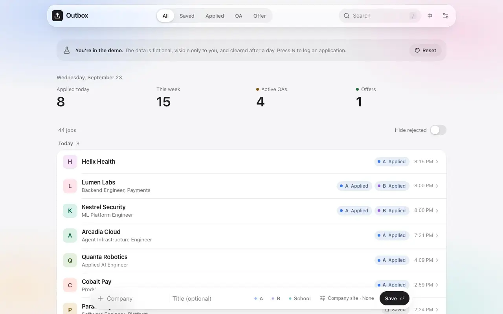
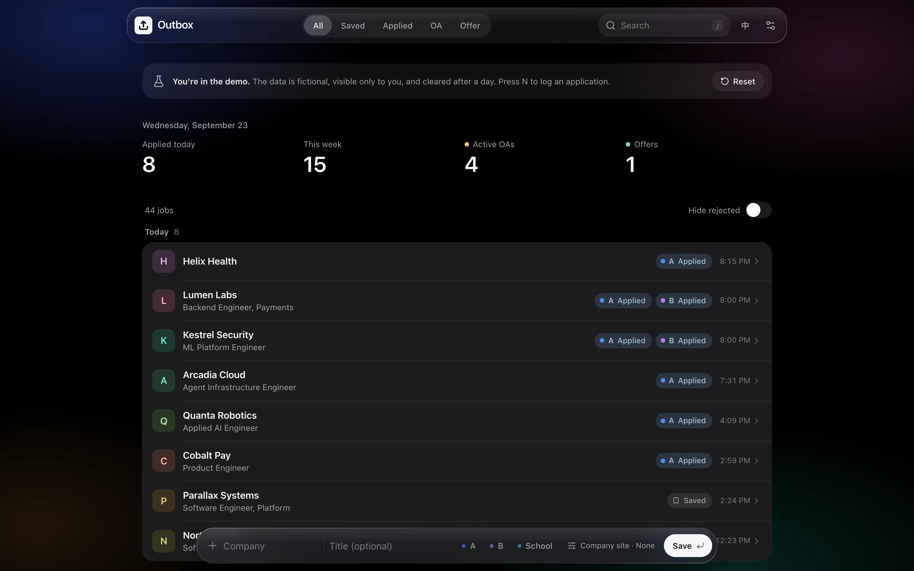
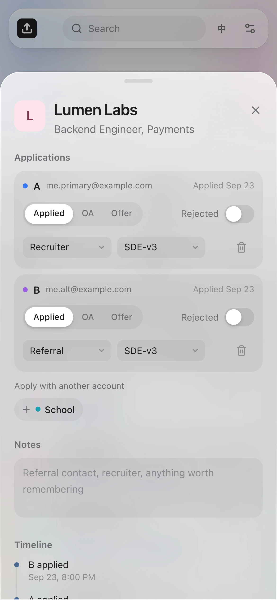
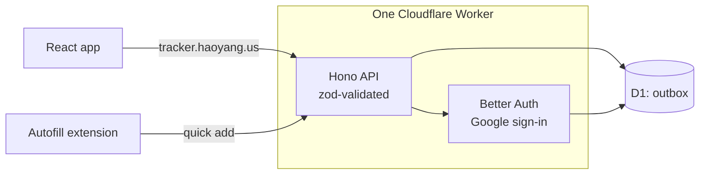

# Outbox

A job-application tracker for people who apply to the same posting from more than one email account. Each
account's application moves through its own stages, logging one takes about five seconds, and the interface
follows Apple's Liquid Glass.



<p align="center">
  
  
</p>

## Features

- **Several accounts, one posting.** Each application records the email identity, channel, and resume version
  it used, and moves Applied → OA → Offer on its own. Rejection is a flag, not a stage, so "rejected after the
  OA" keeps its stage. A posting with no applications yet is simply saved.
- **Logging in about five seconds.** Press `N`, type the company, `Tab` to the title, pick the accounts, press
  `Enter`. Typing a company you've applied to before offers its postings, and accounts that already applied
  can't be picked twice. Or paste the posting's link: the company fills itself in, and a link you've already
  tracked opens its posting, ready for the next account. Adds and deletes can be undone.
- **A list you can scan.** Grouped by day, with today's count against a daily goal, the last 7 days, active OAs
  and the 30-day OA rate, status filters with counts, search (`/`), and a switch to hide rejections. An
  application still at Applied after 30 days reads _No reply_ and fades. Every change lands on the posting's
  timeline.
- **Numbers that say what works.** An Insights page shows the funnel from applied to OA to offer, applications per
  day against the goal, and the OA rate of each resume version, account and channel, for 7 days, 30 days or
  everything.
- **Set up in a few minutes.** A first-run guide walks through the emails you apply with, your resumes, the
  extension and its key, reading a resume into your profile, and the answers no resume holds. A checklist on the
  home page keeps what's left, until the extension logs your first application.
- **Liquid Glass.** Blur, saturation, and a specular rim in every browser, with real refraction (an SVG
  displacement map) in Chromium. Light and dark follow the system; reduced motion and reduced transparency are
  honored.
- English and Simplified Chinese, CSV export, and a layout that works on a phone. Passwords are never stored.

## Autofill extension

A Chrome extension in [`extension/`](extension) fills job applications from a profile the owner keeps in Outbox,
started from their resume PDF, then logs each submission to Outbox. It never presses Submit: the owner checks every answer first.

- **Rules first.** Adapters for Greenhouse, Lever, Ashby and Workday read the form and drive its widgets, and
  a field dictionary answers the questions most forms repeat. Work authorization (sponsorship now or later,
  OPT, export control, clearance) is answered by fixed rules for the job's country, never by a model, and is
  always marked for the owner to confirm.
- **Claude for the rest.** Fields the rules can't place go to Claude in one request per form; anything under
  0.7 confidence stays blank. Essay questions get a short draft grounded in the resume and the posting, for the
  owner to edit.
- **A match check before filling:** citizenship or clearance requirements, seniority, the company's H-1B
  approvals (USCIS, FY2021–2023), and how many of its postings the owner applied to in the last 30 days. It
  warns and never blocks.
- **It logs itself.** When the confirmation page loads, the application lands in Outbox with its account,
  channel, resume version and link, and can be undone. On a posting you'll apply to later, **Save for later** adds
  it to Outbox as a saved job.

Fill accuracy on 22 saved application pages, using rules only (no AI). Every expected answer was checked by
hand:

| System     | Pages | Answers correct | Required fields filled |
| ---------- | ----: | --------------: | ---------------------: |
| Greenhouse |    10 |       172 / 172 |                    87% |
| Lever      |     6 |       115 / 115 |                    79% |
| Ashby      |     6 |         78 / 78 |                    77% |

The required fields left blank are essays and questions only the applicant can answer, such as "Are you
currently a Wealthfront client?". Workday's forms sit behind a sign-in, so its adapter is built from Workday's
`data-automation-id` conventions and tested on a page modeled on them rather than a saved one. The design is in
[docs/autofill.md](docs/autofill.md).

## Architecture



The Worker serves the built app as static assets and runs the API under `/api`.

- **One contract, three implementations.** The UI talks only to a `Repository` interface. It is implemented in
  the browser (the offline prototype), over D1 in the Worker, and over HTTP in the app. The rules for every
  write — what a stage change records on the timeline, what undoing an add removes — are pure functions both
  stores call, and one contract test suite runs against the browser store and against D1 running in workerd.
- **Private by default.** Sign-in is Google only, and only allowlisted addresses can create an account. Every
  query is scoped to the signed-in user, request bodies are validated, cross-site form posts are rejected, and
  configuration lives in Worker secrets.
- **Built for D1.** Multi-row writes go out as one atomic batch, split to fit D1's 100 bound parameters per
  statement; every foreign key is indexed; deletes are soft, so they can be undone.

## Stack

- **App:** React 19, TypeScript, Vite, Tailwind CSS v4, Motion, Radix primitives, TanStack Query
- **Backend:** Cloudflare Workers, Hono, D1 (SQLite) with Drizzle, Better Auth, zod
- **Extension:** Chrome Manifest V3 with WXT, React 19, the Anthropic TypeScript SDK
- **Quality:** Vitest, Playwright, ESLint with the React Compiler rules, Prettier, GitHub Actions

## Develop

```bash
npm install
cp .dev.vars.example .dev.vars   # set BETTER_AUTH_SECRET to any long random string
npm run db:migrate:local
npm run dev                      # http://localhost:5180, signed in as a local developer
npm run dev:local                # the original prototype: sample data in the browser, no backend
npm run ext:build                # the extension, into extension/.output/chrome-mv3
```

## Test

```bash
npm test
```

Covers the domain logic, the repository contract against both stores, and the extension: its rules, its
adapters on the saved pages, and the fill-accuracy report above. CI also type-checks, lints, builds, and runs
the extension end to end in Chromium (`npm run e2e -w extension`) against the saved pages, logging to a mock
Outbox. The free-text eval, which compares Claude models on 20 essay questions, costs money and runs only on
request (`npm run eval -w extension`).

## Deploy

See [docs/deploy.md](docs/deploy.md), which also covers installing the extension. Product and architecture
decisions are in [docs/design.md](docs/design.md).

## Next

An agent that reads recruiting email and keeps statuses current: paste an email (later, Gmail sync) and it
classifies it, matches the application, and updates it, with anything ambiguous held for review. The model is
chosen by an eval set of about 100 synthetic emails: the cheapest that reaches 97% accuracy ships.
