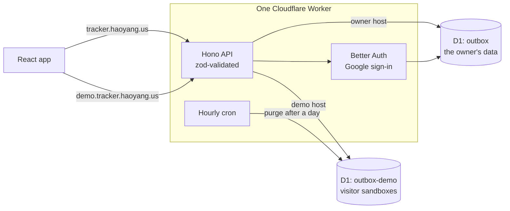

# Outbox

A job-application tracker for people who apply to the same posting from more than one email account. Each
account's application moves through its own stages, logging one takes about five seconds, and the interface
follows Apple's Liquid Glass.

**[Try the demo](https://demo.tracker.haoyang.us)** — a private sandbox of fictional data, no sign-in needed.


<p align="center">
  
  
</p>

## Features

- **Several accounts, one posting.** Each application records the email identity, channel, and resume version
  it used, and moves Applied → OA → Offer on its own. Rejection is a flag, not a stage, so "rejected after the
  OA" keeps its stage. A posting with no applications yet is simply saved.
- **Logging in about five seconds.** Press `N`, type the company, `Tab` to the title, pick the accounts, press
  `Enter`. Typing a company you've applied to before offers its postings, and accounts that already applied
  can't be picked twice. Adds and deletes can be undone.
- **A list you can scan.** Grouped by day, with today's and this week's counts, active OAs, offers, status
  filters, search (`/`), and a switch to hide rejections. Every change lands on the posting's timeline.
- **Liquid Glass.** Blur, saturation, and a specular rim in every browser, with real refraction (an SVG
  displacement map) in Chromium. Light and dark follow the system; reduced motion and reduced transparency are
  honored.
- English and Simplified Chinese, CSV export, and a layout that works on a phone. Passwords are never stored.

## Architecture



The Worker serves the built app as static assets and runs the API under `/api`.

- **One contract, three implementations.** The UI talks only to a `Repository` interface. It is implemented in
  the browser (the offline prototype), over D1 in the Worker, and over HTTP in the app. The rules for every
  write — what a stage change records on the timeline, what undoing an add removes — are pure functions both
  stores call, and one contract test suite runs against the browser store and against D1 running in workerd.
- **The demo can't reach real data.** The Worker picks the database by hostname: the demo host only ever
  opens `outbox-demo`, and sign-in isn't served there. Each visitor gets a sandbox seeded with fictional data
  on their own clock, identified by an HMAC-signed cookie. Starting one is rate-limited per IP and capped per
  day, so demo traffic stays well inside the account's database quota.
- **Private by default.** Sign-in is Google only, and only allowlisted addresses can create an account. Every
  query is scoped to the signed-in user, request bodies are validated, cross-site form posts are rejected, and
  configuration lives in Worker secrets.
- **Built for D1.** Multi-row writes go out as one atomic batch, split to fit D1's 100 bound parameters per
  statement; every foreign key is indexed; deletes are soft, so they can be undone.

## Stack

- **App:** React 19, TypeScript, Vite, Tailwind CSS v4, Motion, Radix primitives, TanStack Query
- **Backend:** Cloudflare Workers, Hono, D1 (SQLite) with Drizzle, Better Auth, zod
- **Quality:** Vitest, ESLint with the React Compiler rules, Prettier, GitHub Actions

## Develop

```bash
npm install
cp .dev.vars.example .dev.vars   # set BETTER_AUTH_SECRET to any long random string
npm run db:migrate:local
npm run dev                      # http://localhost:5180, signed in as a local developer
                                 # http://demo.localhost:5180 runs the demo
npm run dev:local                # the original prototype: sample data in the browser, no backend
```

## Test

```bash
npm test
```

Covers the domain logic, the repository contract against both stores, and the demo: seeding, isolation between
visitors, time zones, purging, and the daily cap. CI also type-checks, lints, and builds.

## Deploy

See [docs/deploy.md](docs/deploy.md). Product and architecture decisions are in [docs/design.md](docs/design.md).

## Next

An agent that reads recruiting email and keeps statuses current: paste an email (later, Gmail sync) and it
classifies it, matches the application, and updates it, with anything ambiguous held for review. The model is
chosen by an eval set of about 100 synthetic emails: the cheapest that reaches 97% accuracy ships.
