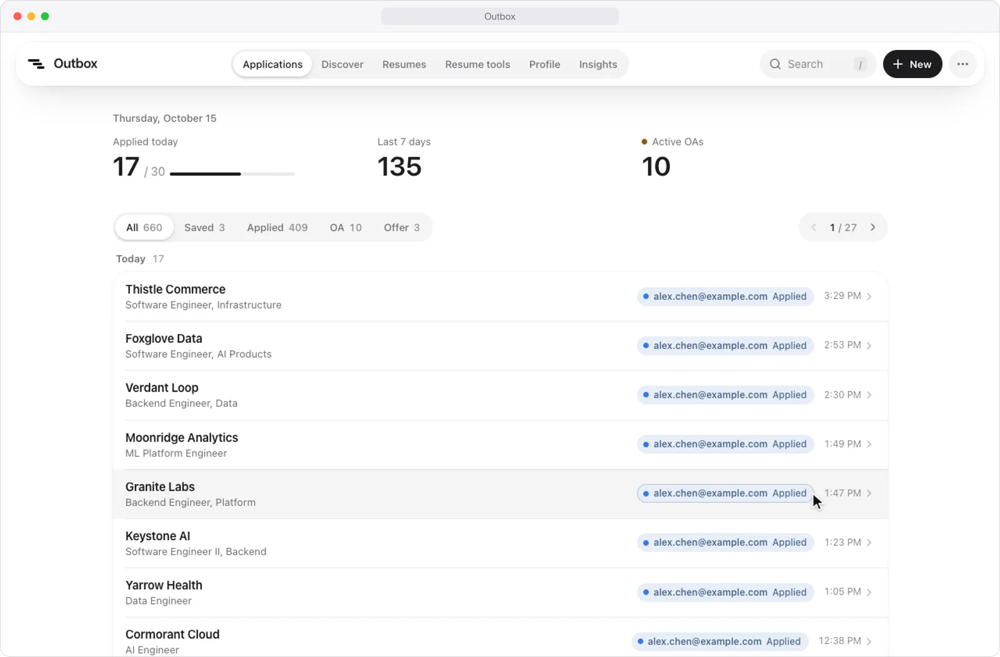

<div align="center">


# Outbox

**用你的个人资料自动填写求职申请，每一份投递都记得清清楚楚。**

求职投递追踪器，配套的 Chrome 扩展用你的个人资料填写申请表，提交后自动记到 Outbox。手动记一条投递大约五秒，数据页告诉你哪份简历、哪个渠道更容易拿到 OA。在本地运行时，还能浏览关注公司的在招岗位，并把简历读进个人资料。

[](tsconfig.json)
[](package.json)
[](wrangler.jsonc)
[](extension)
[](https://github.com/heyemlee/work-tracker/actions/workflows/ci.yml)

[English](README.md) · **简体中文**

[自动填表扩展](#自动填表扩展) · [投递追踪](#投递追踪) · [系统架构](#系统架构) · [技术栈](#技术栈) · [本地开发](#本地开发)

</div>

<p align="center">
  
</p>

<p align="center"><sub>虚构的岗位和资料，申请页是仿 Greenhouse 的替身页面。</sub></p>

## 自动填表扩展

[`extension/`](extension) 里的 Chrome 扩展用你在 Outbox 维护的资料（从简历 PDF 读出、可随时修改）填写求职申请表，提交后把这份申请记到 Outbox。它从不替你点提交：每个答案都由你检查过再提交。

- **规则优先。** Greenhouse、Lever、Ashby、Workday、Gem、iCIMS、SmartRecruiters、Workable 和 Jobvite 各有适配器，读懂表单并操作它的控件；其他带简历上传和姓名或邮箱的表单走通用适配器；字段词典回答各家表单反复出现的问题。工作许可（现在或将来是否需要担保、OPT、出口管制、安全许可）按岗位所在国家用固定规则回答，从不交给模型，并且总会标出来请你确认。
- **剩下的交给 Claude。** 规则放不下的字段，每张表单只发一次请求给 Claude；置信度低于 0.7 的留空。开放式问题会根据简历和岗位写一段简短的草稿，由你修改。
- **填之前先做匹配检查：** 是否要求公民身份或安全许可、资历要求、这家公司的 H-1B 批准记录（USCIS，FY2021–2023），以及近 30 天你投了它几个岗位。只提醒，从不拦着。
- **自动记录。** 提交后的确认页一加载，这份申请就带着渠道、简历版本和链接记到 Outbox，并且可以撤销。在岗位详情页上，**Mark as applied** 不用填表直接记一笔，**Save for later** 把它存为待投递。

只用规则（不用 AI）在 22 个保存下来的申请页上的填写准确率，每个期望答案都人工核对过：

| 系统       | 页面数 |  答案正确 | 必填项填写率 |
| ---------- | -----: | --------: | -----------: |
| Greenhouse |     10 | 172 / 172 |          87% |
| Lever      |      6 | 115 / 115 |          79% |
| Ashby      |      6 |   78 / 78 |          77% |

留空的必填项是开放式问题和只有申请人自己能答的问题，比如「你现在是 Wealthfront 的客户吗？」。Workday 的申请表要登录才能看到，所以它的适配器按 Workday 的 `data-automation-id` 约定实现，并在仿照这些约定的页面上测试，而不是保存下来的真实页面。iCIMS、SmartRecruiters、Workable 和 Jobvite 的适配器在保留了公开页面表单结构的小型样例上测试，还没有计入上表。设计文档见 [docs/autofill.md](docs/autofill.md)。

## 投递追踪

<p align="center">
  
</p>

<p align="center"><sub>公司和岗位均为虚构，界面为「纯白」外观。</sub></p>

- **从待投递到 Offer。** 每条投递记录所用的渠道和简历版本，按「已投递 → OA → Offer」推进。被拒是一个标记而不是阶段，所以「OA 后被拒」仍保留 OA 阶段。还没投的岗位就是「待投递」。
- **五秒左右记一条投递。** 按 `N`，输入公司，`Tab` 到职位，按 `Enter`。输入投过的公司会列出它的岗位。也可以直接粘贴岗位链接：公司自动填好；已经记录过的链接会直接打开那个岗位。添加和删除都能撤销。
- **一眼扫完的列表。** 按天分组，每页 25 个岗位；顶部是今日投递对比每日目标、近 7 天和进行中的 OA；状态筛选带计数，`/` 搜索，还能隐藏被拒的岗位。投递 30 天后仍是「已投递」的会显示为「无回音」并变淡。每次改动都记在岗位的时间线上。
- **用数据说话。** 数据页展示从投递到 OA 再到 Offer 的漏斗、每天的投递量对比目标，以及每个简历版本和渠道的 OA 率，可以看近 7 天、近 30 天或全部。
- **岗位发现与简历工具。** 本地开发时，岗位发现列出你关注的 Greenhouse、Lever、Ashby 公司的在招岗位，保存到追踪器时只记为待投递、不创建投递；简历工具读取 PDF 或 DOCX，只在你点击时才调用模型解析，再把你选中的部分交给资料草稿。两者都依赖 [`backend/`](backend) 里的本地服务，见[主应用内的岗位发现与简历工具](#主应用内的岗位发现与简历工具)。
- **几分钟完成设置。** 首次使用的引导依次带你填写投递用的邮箱、上传简历、装好扩展并填入 key、用简历填好资料，再回答简历上没有的问题。首页的清单保留还没完成的步骤，直到扩展记下第一份投递。
- **Liquid Glass。** 所有浏览器都有模糊、饱和度和高光描边，Chromium 里还有真实的折射（SVG 位移贴图）。四种外观：纯白（默认）、带柔和光晕的浅色、纯黑的深色，或跟随系统。遵循系统的「减弱动态效果」和「降低透明度」设置。
- 中英双语、CSV 导出，手机上也好用。从不保存密码。

## 系统架构

<p align="center">
  
</p>

Worker 把构建好的网页当作静态资源提供，并在 `/api` 下运行 API。扩展从同一个 API 读取资料和简历 PDF，提交后也记到这里；它的 AI key 只存在扩展里，不会传到 Worker。本地开发时，Vite 开发服务器还会把 `/local-tools/*` 转到 `backend/` 里的 NestJS 服务，供岗位发现和简历工具使用；生产构建从不访问它。

- **一份契约，三种实现。** 界面只和 `Repository` 接口打交道。它有三种实现：浏览器里（离线原型）、Worker 里基于 D1、网页里基于 HTTP。每一次写入的规则——阶段变化在时间线上记什么、撤销添加会删掉什么——都是两种存储共用的纯函数，同一套契约测试分别跑在浏览器存储和 workerd 里运行的 D1 上。
- **默认私有。** 只能用 Google 登录，并且只有白名单里的邮箱能创建账号。每个查询都限定在当前登录用户名下，请求体都经过校验，跨站表单提交会被拒绝，配置都放在 Worker secrets 里。
- **为 D1 设计。** 多行写入作为一个原子批次发出，并按 D1 每条语句最多 100 个绑定参数拆分；每个外键都有索引；删除是软删除，所以能撤销。

## 技术栈

| 层       | 技术                                                                             | 作用                                                        |
| -------- | -------------------------------------------------------------------------------- | ----------------------------------------------------------- |
| 网页应用 | React 19 · TypeScript · Vite · Tailwind CSS v4 · Motion · Radix · TanStack Query | 投递列表、岗位发现、数据页、资料、简历和首次使用引导        |
| API      | Cloudflare Workers · Hono · zod · Better Auth                                    | 一个 Worker 同时提供网页和 `/api`；白名单邮箱用 Google 登录 |
| 数据     | D1（SQLite）· Drizzle                                                            | 岗位、投递、时间线、个人资料和简历 PDF                      |
| 扩展     | Chrome Manifest V3 · WXT · React 19 · pdf.js · Anthropic TypeScript SDK          | 按规则填写申请表，其余交给 Claude，提交后自动记录           |
| 本地服务 | NestJS · Prisma · PostgreSQL                                                     | [`backend/`](backend)：岗位发现的同步、简历工具的解析       |
| 质量     | Vitest · Playwright · ESLint（含 React Compiler 规则）· Prettier                 | 领域、契约和适配器测试；CI 里在 Chromium 中端到端测试扩展   |

本地服务由 NestJS + Prisma + PostgreSQL 提供，只在本机为一个人运行。主应用在本地开发模式接入了「岗位发现」和「简历工具」；原登录、投递、资料、附件及扩展继续使用 Worker/D1，不迁移数据库。Redis 仍仅用于独立性能实验，不放入日常导航。安装说明见 [backend/README.md](backend/README.md)。

## 本地开发

```bash
npm install
cp .dev.vars.example .dev.vars   # 把 BETTER_AUTH_SECRET 设为任意一串足够长的随机字符
npm run db:migrate:local
npm run dev                      # http://127.0.0.1:5180，以本地开发者身份登录
npm run dev:local                # 最初的原型：样例数据存在浏览器里，不需要后端
npm run ext:build                # 构建扩展，输出到 extension/.output/chrome-mv3
```

### 主应用内的岗位发现与简历工具

保留已有 `backend/.env`、模型配置和预算账本。首次安装按 [后端说明](backend/README.md) 准备数据库；之后另开终端启动：

```bash
npm --prefix backend run infra:up
npm --prefix backend run dev      # 127.0.0.1:3100，与根目录 npm run dev 同时运行
```

- [岗位发现](http://127.0.0.1:5180/discover)：先选择关注公司；公司搜索与添加放在独立弹窗，主页面保留搜索和紧凑岗位列表，筛选按需展开，详情在侧栏打开。支持 Greenhouse、Lever、Ashby。保存时复查追踪器并按已有岗位匹配规则去重，只生成待投递岗位，不创建申请或标记已投递。
- [简历工具](http://127.0.0.1:5180/resume-tools)：按“添加简历 → 核对原文 → 审阅结果”推进，本地读取 PDF/DOCX（最大 5 MB）或粘贴文字。点击“开始解析”后调用模型，结果先显示可读摘要，JSON 默认折叠；模型配置放在“解析设置”弹窗中。支持函数调用和结构化输出、JSON 下载及资料审阅。访问页面、读文件均不调用付费模型。模型列表和连接检查也只在点击时执行。
- 模型设置沿用现有服务、型号、Base URL 与共享 $5 账本。本次整合没有新增付费请求。主应用不读取或接收密钥；密钥及目标地址在 `backend/.env` 配好后重启服务。预算预留不是第三方实际账单，也不是第三方账单硬限额。
- 解析结果进入原资料页后逐项选择：联系方式只填空白；选中的教育、经历替换对应草稿部分；技能合并。仍需检查并点击保存，未保存更改有离开保护。文字和结果仅保留在本次页面内存，刷新会丢失。原简历库及扩展附件仍只接受 PDF，扩展解析入口保留。

两个页面都有独立路由，支持刷新和前进后退，共用原主题、玻璃效果和中英文文案。窄屏导航显示投递、岗位发现、简历工具和“更多”，简历库、资料、数据在更多菜单中。

本地开发通过 `/local-tools/*` 连接固定回环服务，检查本机 Host、来源、连接地址和本地请求头后，才转为后端要求的同源请求。主站 Cookie/Authorization 不会被转发，原 Worker `/api/*`（包括 PDF 附件）保持独立。不能将开发服务直接开放到公网。

**本地整合已完成，线上托管尚未安排。** 生产构建显示明确的未接入状态，不访问访客的 localhost。真正上线还需要单独托管服务与 PostgreSQL、实现按登录用户隔离的数据/密钥/预算以及生产同源网关。现有后端仍是本机单用户工具。前端与主应用沿用现有 Cloudflare 部署；这不会托管本地服务或搬迁数据库。

网页应用和扩展共用 `src/assets/outbox.svg` 这个标志。改了它之后运行 `npm run icons`，重新生成网站图标、主屏幕图标和 Chrome 扩展图标，再重新构建两边。

## 测试

```bash
npm test
npm run test:ui                  # 主应用浏览器测试；虚构本地资料及模拟模型响应
```

`npm test` 覆盖领域逻辑、两种存储上的 Repository 契约，以及扩展：它的规则、在保存的页面上的各个适配器，和上面的填写准确率报告。CI 还会做类型检查、lint、构建，并在 Chromium 里对保存的页面端到端运行扩展（`npm run e2e -w extension`），记录到一个模拟的 Outbox。比较各个 Claude 模型回答 20 道开放式问题的文本评测会产生费用，只在需要时运行（`npm run eval -w extension`）。

主应用浏览器测试（`npm run test:ui`）覆盖导航/刷新/前进后退、公司选择与同步、岗位保存去重、主动解析与资料选择合并、未保存保护、服务未启动提示，以及 320–1440 像素的中英文和深浅主题。仅额外进行本地服务只读健康检查与被拒绝的跨来源请求，不调用付费模型。截图位于 `docs/screenshots/local-tools-*` 和 `docs/screenshots/discover-*`，均使用虚构资料。`npx vitest run` 单独运行主应用、Worker 和本地连接测试。

## 部署

见 [docs/deploy.md](docs/deploy.md)，里面也讲了怎么安装扩展。产品和架构上的决定见 [docs/design.md](docs/design.md)。
