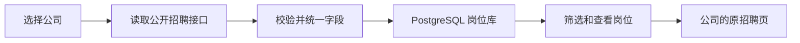

# Outbox 本地补充模块

一个独立的本地模块：选择想关注的公司，把它们的公开招聘岗位放在一起看。原来的 Outbox 追踪器和扩展继续使用原来的代码、数据库和部署方式。

## 使用

在此目录运行，第一次安装并准备数据库：

```sh
cd backend
npm ci
npm run infra:up
npm run setup
npm run dev
```

打开 <http://127.0.0.1:3100>，搜索并勾选公司，然后点击“更新岗位”。你可以按职位关键词、地点、公司和远程条件筛选，查看岗位详情，并打开公司的原招聘页申请。取消关注会隐藏岗位，保留历史数据；重新关注后可以继续更新。

公司目录只是可选择的招聘源，默认全部未关注。添加目录中没有的公司时，填写公司名称及其 Greenhouse、Lever 或 Ashby 招聘页链接；系统会先验证招聘源。数据源可能更换或暂时不可用，界面会显示更新失败并保留原岗位。

默认手动更新。需要每日更新时，将 `.env.example` 复制为 `.env`，设置 `ENABLE_SYNC=true`，保持服务运行；它会在洛杉矶时间每天凌晨 4 点更新已关注的公司。也可用 `npm run sync` 手动更新。停止本地数据库用 `npm run infra:down`。

该页面供本机一个用户使用，服务仅监听回环地址。它没有接入线上登录或追踪器。前往原招聘页后，现有扩展可以继续工作。

页面沿用主项目的颜色变量、品牌 SVG 和玻璃效果。右上角“外观”可选择纯白、浅色、深色或跟随系统，选择会在该页面的浏览器中保留；不同端口的浏览器存储独立，不会改动原 Outbox 的主题设置。手机上可展开“关注的公司”面板进行选择。

## 数据怎样流动



- `Board` 保存招聘来源、是否关注、最近成功更新时间和错误信息；`Job` 保存统一的岗位字段。
- 三个 connector 读取各自的公开接口；Lever 的分页全部读取成功后才写库。接口定义见 [Greenhouse](https://docs.greenhouse.io/job-board.html)、[Lever](https://github.com/lever/postings-api)、[Ashby](https://developers.ashbyhq.com/docs/public-job-posting-api)。
- `(boardId, externalId)` 唯一约束保证同一来源的岗位重复获取时更新已有记录。不同来源的岗位保持独立，避免把职位名相同的不同招聘名额合并。
- 一家公司的完整数据在一个事务内写入。成功读取后，将本次没有出现的岗位标为下架；再次出现时恢复招聘状态。
- 请求超时、分页失败、响应格式错误会保留旧岗位，不把网络故障解释成全部下架。
- 公司取消关注后，列表和详情都会隐藏其岗位；同步时再次检查关注状态，跳过获取期间被取消关注的公司。
- 查询使用参数化 SQL。全文搜索及排序索引对应实际筛选需求。

## 验证

```sh
npm run build
npm run lint
npm run format:check
npm test
npm run test:integration
npx playwright install chromium
npm run test:ui
```

集成测试需要本地 PostgreSQL，覆盖公司选择、搜索、数据保留、去重、下架、重新上架和同步期间取消关注。浏览器测试覆盖岗位操作和外观/手机布局，不提交真实申请。

这是单独的 Node 工程，有自己的依赖锁文件和检查命令；主工程原有命令和 CI 保持原样。`.archive/previous-experiment.tar.gz` 是上一轮超出范围的实验代码备份，已从 Git 和本模块运行流程中排除。

`npm run build` 会先从主项目的 `src/index.css`、`src/assets/outbox.svg` 和玻璃折射实现生成只读的前端资源。它们输出到被 Git 忽略的 `web/.generated/`；修改主项目的视觉规范后，运行 `npm run design` 即可更新聚合页面，不需要维护两份配色。
