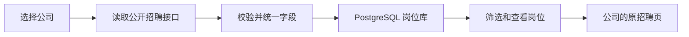

# Outbox 本地补充模块

一个独立运行的本地服务：选择想关注的公司，把它们的公开招聘岗位放在一起看。现已接入 Outbox 主应用的“岗位发现”和“简历工具”页面；原追踪器和扩展继续使用原来的数据库和部署方式。

推荐从主应用访问：本服务运行在 `127.0.0.1:3100` 时，在仓库根目录运行 `npm run dev`，打开 <http://127.0.0.1:5180/discover> 或 <http://127.0.0.1:5180/resume-tools>。主应用通过仅限本地开发的同源连接使用本服务，岗位可保存到原追踪器，解析结果可交给原资料页选择并合入草稿、检查后保存。主应用模型设置不接收或返回密钥，沿用 `.env` 中的配置；原独立页面继续保留。

## 使用

在此目录运行，第一次安装并准备数据库：

```sh
cd backend
npm ci
npm run infra:up
npm run setup
npm run dev
```

打开 <http://127.0.0.1:3100>，搜索并勾选公司，然后点击“更新岗位”。你可以按职位关键词、地点、公司和远程条件筛选，查看岗位详情，并打开公司的原招聘页申请。取消关注会隐藏岗位，保留历史数据；重新关注后可以继续更新。

公司目录只是可选择的招聘源，默认全部未关注。添加目录中没有的公司时，填写公司名称及其 Greenhouse、Lever 或 Ashby 招聘页链接；系统会先验证招聘源。数据源可能更换或暂时不可用，界面会显示更新失败并保留原岗位。

默认手动更新。需要每日更新时，将 `.env.example` 复制为 `.env`，设置 `ENABLE_SYNC=true`，保持服务运行；它会在洛杉矶时间每天凌晨 4 点更新已关注的公司。也可用 `npm run sync` 手动更新。停止本地数据库用 `npm run infra:down`。

该服务供本机一个用户使用，仅监听回环地址。主应用已完成本地流程整合，但服务尚未接入线上认证或多用户隔离。线上没有托管服务时，主应用会显示准确的不可用说明，不请求访客本机。前往原招聘页后，现有扩展可以继续工作。上线需要另行安排服务和数据库托管、用户隔离及生产同源网关，本次没有部署。

页面沿用主项目的颜色变量、品牌 SVG 和玻璃效果。右上角“外观”可选择纯白、浅色、深色或跟随系统，选择会在该页面的浏览器中保留；不同端口的浏览器存储独立，不会改动原 Outbox 的主题设置。手机上可展开“关注的公司”面板进行选择。

## 独立简历解析入口

打开 <http://127.0.0.1:3100/resume-lab>，或点击工具栏的“简历解析”：

1. 选择 PDF / DOCX，点击“读取文字”，核对并修正原文。这一步只在本机处理，不调用模型，不保存上传文件。
2. AI 服务启用后，可选择 function calling 或 structured output，再点击“解析资料”。只有这一步会将核对后的原文发送给所选的 OpenAI / Anthropic API，并产生费用。
3. 对照原文检查提取结果，可下载资料 JSON。本入口不写入原追踪器的个人资料，也没有改动原扩展的 PDF 解析方式。

文件最多 5 MB，PDF 最多 30 页，文字最多 60,000 字符；超过限制会报错，不会默默截掉内容。扫描页会提示需要 OCR，本入口没有加入 OCR。复杂多栏布局、页眉和图片可能丢失内容，必须核对提取原文。读取在可超时终止的独立线程内运行，DOCX 另有限制解压体积和文件数。

AI 默认关闭。现在可直接在本地“简历解析 → 模型设置”里选择 **OpenAI / 兼容服务**，填写 Base URL 和对应的 API Key、点击“获取模型列表”，搜索并选择账号返回的型号，再点击“保存配置”。填写的密钥无需先保存就能获取列表；已经保存过的密钥也可直接使用。刷新列表和搜索会保留当前选择，不会自动切换到首个型号。保存后立即生效，不需要重启。也可继续选择 Anthropic 的 Sonnet / Opus。密钥使用密码框，保存后清空输入框，只回显“密钥已配置”；留空再次保存会保留已存密钥，也可用“移除密钥”删除它。

Base URL 默认 `https://api.openai.com/v1`，支持 HTTPS 兼容服务和本机 HTTP 服务（localhost、127.0.0.1、IPv6 回环）。只填域名时自动补 `/v1`，已有路径完整保留，忽略末尾斜杠；不要填写 `/responses` 或 `/chat/completions` 等完整接口地址，也不要在地址中放密钥、查询参数或用户密码。模型列表、连接检查和两种解析方式都使用同一个地址，分别追加 `/models`、`/models/<model>`、`/responses`。兼容服务需支持 Responses API 及对应的严格工具调用 / JSON schema；只支持 Chat Completions 的服务尚不适用。

更换 Base URL 会清除网页中旧的模型列表，并要求重新填写对应密钥；服务端也拒绝将已保存的旧密钥自动发送到新地址。模型目录同时绑定地址和密钥。保存后地址与密钥写入同一个本地配置文件，CLI 也读取 `OPENAI_BASE_URL`。预算仍采用已核对的官方标准价格作预留参考，第三方实际费率不由模型列表提供，须按服务商报价另行核对，不能把本地账本视作第三方账单硬限额。

列表来自所填地址的 [Models API](https://developers.openai.com/api/reference/resources/models/methods/list)，获取时不保存密钥、不发送简历、不生成内容。该接口不提供价格与结构化解析能力，因此保留完整账号列表并附带本地提示：音频、图像生成、嵌入等型号置灰；尚未核实的文本型号可选并保存，但暂停付费解析。已核实两种解析方式与标准价格的 OpenAI 型号包括 GPT-6.1 Sol、GPT-6 Astra / Luna / Sol、GPT-5.6 Sol、GPT-5.4 / mini、GPT-4.1 / mini 和 GPT-4o mini，实际可用性以账号权限和真实调用为准。价格依据各型号的官方页面，核对日期 2026-10-14；超长上下文价格适用时也纳入预算预留。

密钥写入本模块被 Git 忽略的 `.env`，通过临时文件原子替换并设为仅当前用户读写（0600）；它是本地明文配置文件，不是加密密码库。服务只监听本机，配置接口要求同源及本地请求头。密钥不写入浏览器存储、不经 GET 返回，不放进样本或报告。原数据库等配置会保留。网页解析和评测 CLI 读取相同的提供方/模型/密钥设置。

“检查连接”只访问所选提供方的模型信息接口，不发送简历、不生成内容；连接成功不能替代真实结构化解析验证。只有点击“解析资料”才会发送原文。OpenAI 使用 Responses API、`store:false`，分别支持严格 function calling 与 JSON schema structured output，仍以本地 Zod 校验作为最后一道检查。所有 OpenAI 请求使用保存的 Base URL；重定向不会自动跟随，也不会失败后切换到其它地址或接口。

如选择手动配置，在 `.env` 中使用 `RESUME_PROVIDER=openai`、`RESUME_MODEL=gpt-5.4-mini`、`OPENAI_BASE_URL=https://api.openai.com/v1`、`OPENAI_API_KEY` 和 `ENABLE_RESUME_AI=true` 后重启；旧的无 `RESUME_PROVIDER` 的 Claude 配置仍按 Anthropic 读取。单元测试与页面测试使用模拟响应；真实模型验证进展见下方记录。

两种调用使用同一组资料字段：姓名、联系方式、城市/州/国家、个人链接、教育、经历、技能、语言和简介，和现有 `ResumeFacts` 兼容。工具调用通过 `extract_resume` 的参数返回资料；结构化输出通过 JSON 返回。服务端再用严格 Zod schema 校验必填键、枚举和日期。拒答、截断、多次/缺失工具调用、额外字段、非法日期都会作为失败返回，不自动补值、重试或写入资料。**字段校验通过只说明格式正确，不能证明内容真实。**

实现依据：[Mammoth 原文提取](https://github.com/mwilliamson/mammoth.js#library)、[PDF.js](https://mozilla.github.io/pdf.js/api/)、[Claude tool use](https://platform.claude.com/docs/en/agents-and-tools/tool-use/strict-tool-use) 与 [structured outputs](https://platform.claude.com/docs/en/build-with-claude/structured-outputs)，以及 [OpenAI function calling](https://developers.openai.com/api/docs/guides/function-calling) / [structured outputs](https://developers.openai.com/api/docs/guides/structured-outputs)。实际模型、账户权限和费用还需在启用时验证。

## 简历解析评测

先完成构建，再做免费的文件读取检查：

```sh
npm run build
npm run resume -- extract evals/synthetic/sample.docx
npm run resume -- plan evals/synthetic/manifest.json
```

`evals/synthetic/` 只有**同一份虚构简历的两种文件格式**，用于检查流程，不是实际准确率数据集。金标准是手写的资料字段，重建这些文件可运行 `node dist/scripts/resume-fixtures.js`。单元测试中的模型响应都是模拟值，不计入真实解析效果。

实际评测时，把获得授权的简历、人工核对的完整 gold JSON 和 manifest 放在被 Git 忽略的 `evals/private/`。manifest 格式见合成样例，每例记录来源、许可/同意、文件路径和 gold 路径。相对路径以 manifest 所在目录为准，ID 必须唯一；公开数据也要先检查具体许可和隐私条件。本模块仅提供下面两份已核对许可证的固定公开来源下载，不自动抓取其它简历集。

在核对模型费用并准备好数据后，才使用以下付费命令（不会因 `plan` 或测试而执行）：

```sh
mkdir -p evals/runs
npm run resume -- run evals/private/manifest.json evals/runs/function-calling.jsonl --live --budget-usd=5 --method=function-calling
npm run --silent resume -- score evals/private/manifest.json evals/runs/function-calling.jsonl > evals/runs/function-calling-score.json
```

对比结构化输出时，改为 `--method=structured-output`，并指定另一个新结果文件。运行命令还要求显式启用 AI，结果文件不得已存在；每份简历只请求一次，无自动重试；首例失败即停，后续缺少的预测仍计入评分。逐例保存成功/失败、输入文件 SHA-256、模型、方式、提示词版本和调用元数据，避免把失败样本丢掉。

评分计算非空字段的精确匹配 precision / recall，并列出漏提取、多提取、值不一致和失败样本：

- 忽略大小写、连续空白和 Unicode 宽度差异；不做模糊匹配，不把空字段计为正确答案。
- 技能和语言按集合比较；教育/经历按记录顺序比较，顺序错误也会产生差异。人工标注应遵循同样的“最新在前”规则。
- 请求失败或缺少预测的样本，其 gold 字段仍计入 recall 分母；没有预测值时 precision 为 `null`，不伪装成 100%。
- 合成/授权/公开许可样本分别标记；报告不能据此声称“测过 500 份真实简历”。更改输入文件后，带有旧 hash 的预测会被拒绝评分。

原文、提取结果和差异报告都可能含个人资料，应留在 `evals/private/`、`evals/runs/`，不要加入 Git。网页本身不使用本地存储保存简历；刷新或清空即可移除本次显示内容，主动下载的 JSON 由你保管。

### 公开样本与首次模型验证（2026-10-14）

当前有效样本为 [karasinski/Resume](https://github.com/karasinski/Resume)（MIT）和 [Igor Zarvanskyi 的 clutcher/cv](https://github.com/clutcher/cv)（CC-BY-SA-4.0）。固定提交、PDF 和许可证据的 SHA-256 记录在 `evals/public-sources.json`，下载时强制校验并保留许可证据。clutcher 原 PDF 未修改，参考标签为注明作者与改动的 schema 转录，按 CC-BY-SA-4.0 保留。

**来源复核更正：** 早期 edunham 样本的源文件明确将 MIT 限定为 LaTeX 代码，正文许可范围不明确，且同一提交的 TeX 与旧 PDF 内容不同。因此移出后续公开许可评测；旧文件、标签、预测和费用记录保留为历史，不能再称两份旧样本均已确认正文 MIT 许可。CLI 在创建新预测文件或预留费用前拒绝该 PDF 的 SHA-256。后面的 v1 运行数据仅为历史记录。

```sh
npm run build
npm run resume:data
npm run resume -- plan evals/private/public-v2/manifest.json
npm run resume -- quote evals/private/public-v2/manifest.json
```

原件与参考答案留在被 Git 忽略的 `evals/private/public-v2/`。下载脚本只准备许可及原件，不生成 gold；换机器后需单独准备与核对参考答案。当前标签是 **agent-reviewed**：代理逐页查看 PDF，并对照内容一致的 TeX/Markdown，仍不是独立人工标注。`reference-audit.json` 记录原文页码、断词修正和取值约定。用户已确认经历只纳入工作、合同和实习，社区及志愿经历另列复核；提示词更新为 `resume-lab-v2`，限定显式技能、共享描述归属、实习/合同优先级和未知日期。原有 Outbox 简历解析入口与 schema 未改。

评分仍按字段位置、Unicode/大小写/空白规范化后严格比较，不为提高分数放宽规则。共享描述只挂最新角色、年限换成月份、默认 employment type 等都是表示约定，不代表额外事实。两位作者是开发样本，不能据此宣称可靠准确率。离线 quote 使用网页保存的模型，按完整请求保守预留；不是 token 精确估计或供应商账单。

用户已授权首次合计上限 **$5**。CLI 要求显式 `--budget-usd`，并对两种方式、不同 manifest、反复运行共同使用包目录内 `evals/private/budget-ledger.json`：先落盘预留，再发请求；并发加锁；失败/超时不退回预留；记录已知 usage 与保守预留两项；余额不足、价格未知或账本损坏时拒绝请求。预留不是供应商账单硬限额；若供应商 usage 超过预留，后续运行立即停止，需要检查账单。网页解析也共用同一账本与 $5 上限，保存配置或切换提供方不会重置余额。这不是整个 API 账户的费用限额。

API Key 在网页的模型设置区保存即可，不需要发到聊天、命令参数或报告。网页“启用 AI 解析”可控制交互入口；下面命令仅在该次 CLI 进程中启用 AI。密钥配置后，在 backend 目录运行（结果文件须为新文件；模型请求会向所选提供方发送简历原文）：

```sh
mkdir -p evals/runs
ENABLE_RESUME_AI=true npm run resume -- run evals/private/public-v2/manifest.json evals/runs/public-function-v2.jsonl --live --budget-usd=5 --method=function-calling
npm run --silent resume -- score evals/private/public-v2/manifest.json evals/runs/public-function-v2.jsonl > evals/runs/public-function-v2-score.json
ENABLE_RESUME_AI=true npm run resume -- run evals/private/public-v2/manifest.json evals/runs/public-structured-v2.jsonl --live --budget-usd=5 --method=structured-output
npm run --silent resume -- score evals/private/public-v2/manifest.json evals/runs/public-structured-v2.jsonl > evals/runs/public-structured-v2-score.json
```

两份真实样本均为 PDF。DOCX 仍由同一份虚构简历的独立格式样例验证，不能计为额外真实样本。真实模型响应与字段差异的已完成验证见下方；实际供应商账单费用尚未核实。未部署 AWS。

### 已配置后的首次尝试（2026-10-14）

用户在网页保存了 Kabi Base URL 与 GPT-6.1 Sol。模型信息连接检查通过，但首次真实 function calling 请求返回 HTTP 503，立即停止，没有自动重试或切换模型。两份样本 × 两种方式原计划四次调用，实际只尝试第一份 PDF 的工具调用；成功解析为零，其余三次未发送。不能据此计算解析准确率，也不能将模型信息可访问表述为真实解析已验证。

本次运行记录保存在本机被忽略的 `evals/runs/2026-10-14-gpt-6.1-sol-995ee1f1/summary.json` 和同目录 `function-calling.jsonl`。共享账本保留约 $0.172472 的官方标准价参考预留，供应商未提供该请求的已核实收费，实际账单费用未知；不能把预留等同于实际消费。Kabi 实际费率也未从公开信息独立确认。当时停止并等待用户选择下一步；后续授权重试的结果见下方。参考答案仍待人工复核。

### 用户授权重试后的验证结果（2026-10-14）

用户明确选择保留 GPT-6.1 Sol 并重试一次。同一份简历的 function calling 重试成功后，继续完成原定其余三次请求。最终两位作者的原始 PDF 均完成两种解析，四份返回结果全部通过严格 Zod 校验。累计实际尝试五次：首次 HTTP 503 一次、用户授权重试一次及后续三次；没有自动重试，也没有切换模型、改提示词或修改参考标签来迎合分数。

| 方式              | 成功解析 | 草稿参考字段匹配数       | Precision | Recall |
| ----------------- | -------- | ------------------------ | --------- | ------ |
| Function calling  | 2 / 2    | 148 / 183 个参考非空字段 | 72.9%     | 80.9%  |
| Structured output | 2 / 2    | 146 / 183 个参考非空字段 | 71.9%     | 79.8%  |

这些是 **agent-draft 参考标签的严格字段一致性**，不是已验证的解析准确率。两份 PDF 样本太少，记录按位置比较；是否纳入社区/志愿角色会让后续经历整体错位。两种方式都提取了九条工作/社区角色，参考草稿仅纳入五条就业角色；组合技能与拆分标签也会产生分差。另有一项可确认的遗漏：原文明示 Computer Science coursework，structured output 的专业字段为空，而 function calling 保留了该字段。NASA 的同一岗位同时写有 Intern 与 Contractor，单一类型枚举的取值，以及多角色共用经历描述的归属，仍待人工裁定。原始预测与草稿标签均保持不变。

完整结果、逐字段差异和调用用量保存在本机被忽略的 `evals/runs/2026-10-14-gpt-6.1-sol-retry-d983ce47/summary.json` 及其同目录。共享账本累计保留 **$0.939512**，包含首次失败的预留；成功请求 usage 按 OpenAI 标准参考费率折算约 **$0.072902**，并非已核实的 Kabi 实际收费。Kabi 实际账单费用未知。总授权上限仍为 $5，未重置账本。

这一历史阶段完成的是两份 PDF 的小批调用。后续来源复核撤回了其中一份样本，见上方更正与下方 v2 记录。真实许可 DOCX、大样本和独立人工复核仍未完成；不能声称测试过数百份简历。扩展验证边界见 `extension/test/fixtures/new-ats/README.md`。

### 来源与标签复核后的验证（2026-10-14）

按用户选择固定 employment-only 口径，逐页核对两份有效 PDF 与相应源文档，修正 8 处断词/排版内容，并记录共享描述、实习/合同、学历候选资格、未知日期和技能分组的规则。标记为代理复核，未冒充独立人工标注。撤回的样本与全部旧报告保持原样，后续调用改用许可明确的替代样本。

在生成并冻结 v2 标签后，用原保存的 Kabi / GPT-6.1 Sol 分别调用两种方式，共四次请求，全部成功并通过严格 Zod 校验。两种方式各匹配 **199 / 205** 个参考非空字段（预测 204 个）；严格 Precision **97.55%**、Recall **97.07%**，均标记 provisional。六处严格差异为网址末尾斜杠一处、校名引号样式三处，以及暑期学校完整名称与专业拆分两处；保留全部差异，没有据此改标签或放宽评分。

结果在本机 `evals/runs/2026-10-14-source-reviewed-v2-db6c855b/`，包括冻结标签、四份预测、逐字段报告、复核说明及文件校验值。v2 换了样本并明确了提示词，**不能与 v1 分数直接比较来宣称准确率提升**。这是两位开发样本的字段一致性，仍缺独立人工复核、更大且有代表性的留出集和真实 DOCX 验证。

共九次推理尝试（含历史失败），共享账本累计保守预留 **$1.791608 / $5**，成功 usage 按官方标准参考费率折算 **$0.162964**；历史失败一次仍保留预留。Kabi 实际账单未知，账本未重置。没有自动重试、改模型或部署 AWS。

SmartRecruiters 的空白经历/教育编辑器已查看真实渲染结构；标准筛选题按该页面发布的组件源码重建并在本地扩展中验证。没有填写真实候选人数据或进入真实筛选步骤。iCIMS 在用户操作邮箱入口后已查看真实 Candidate Profile 的字段与下拉列表，补测懒加载菜单、非空占位提示、可见控件必填标记、含数字的字段 ID 和候选人链接清理。最初资料页仍含 Create a login 与新密码区，不能计作已完成登录；注册表单继续禁止填写，无凭据的资料样例是派生版本。

用户随后进入了真实 **Candidate Questions** 页，已只读核对两道必填资格题及 Finish Later / Submit 按钮，并据此增加本地扩展测试。再次检查发现它是 **第 2/3 步**，后面还有 EEO；这里的 Submit 也只是进入后续步骤，不能仅凭按钮文字识别最终投递。题目页不再依赖姓名字段识别，资料页 Next、保存进度和仍有后续步骤的 Submit 均不再被当作正式投递。资格题沿用现有规则并要求用户确认，多国家提问的既有美国优先口径没有改动，也没有交给模型推断。没有在真实页面选择答案或提交申请；EEO 控件、其他公司定制表单、最终提交与确认页仍不属于这次覆盖范围。详见扩展样例说明。

## 数据库性能实验

性能实验在独立数据库 `outbox_performance_lab` 中运行，使用固定规则生成的虚构公司、岗位和历史记录。它不导入真实简历、会话或投递数据，不接入现有 API 和页面。

```sh
npm run perf:up
npm run build
npm run perf
```

默认生成 20,000 条岗位和两份各 120,000 行的历史记录，每条 SQL 先预热两次、再测 11 次。可显式设置 `--rows=50000 --repetitions=21 --requests=240 --concurrency=8`，各参数有上下限。环境检查限定本机专用端口与实验库名，不读取应用的 `DATABASE_URL`；同名数据库须有本实验的标识，否则拒绝修改。

报告保存在 `performance/results/<时间和运行标识>/REPORT.md`，同目录 `results.json` 包含原始样本、SQL、参数、结果 hash、执行计划和环境信息。每次产生新目录，不覆盖旧报告：

| 实验     | 对比与验证                                                               | 与现有功能的关系                         |
| -------- | ------------------------------------------------------------------------ | ---------------------------------------- |
| 索引     | 保留约束的基线 → 加入当前岗位库已有的索引；查询结果和顺序一致            | 解释既有索引设计，不更改当前岗位表       |
| 物化视图 | 实时公司统计 → 预计算统计；更新后验证旧快照和刷新成本                    | 当前公司列表继续实时统计                 |
| 分区     | 普通历史表 → 12 个月分区；两边使用相同数据和索引，分别查询单月与全部历史 | 只使用模拟历史，不迁移岗位 ID 或投递记录 |
| Redis    | 同一批查询的直接读库、冷缓存、热缓存；记录延迟与岗位 SELECT 次数         | 实验独用缓存，现有接口继续直接读库       |

缓存还覆盖过期、数据 revision 失效、关注范围隔离、同键并发请求合并、损坏内容、读写失败，以及 Redis 断连后的数据库回退。数据同步或关注公司改变后，未来接入方须更新 revision；TTL 只提供有限时间的旧数据兜底。当前没有新增会话系统或会话缓存。

每轮结束会移除该轮临时 schema，并只删除该轮 Redis 键；不会重建实验库、清空 Redis 或修改当前岗位库。Redis 使用单独的 Compose profile、服务名和本机端口 `56380`，不持久化。完成后可运行 `npm run perf:stop` 关闭这一实验缓存，现有 PostgreSQL 保持运行。

这是本机、合成数据、预热后的对照实验。数据库查询次数不等于数据库 CPU 或整体负载；报告会显示没明显改善的查询、分区裁剪范围、索引空间和视图刷新开销。这里只测试读路径，没有把结果换算成线上性能承诺。

## 数据怎样流动



- `Board` 保存招聘来源、是否关注、最近成功更新时间和错误信息；`Job` 保存统一的岗位字段。
- 三个 connector 读取各自的公开接口；Lever 的分页全部读取成功后才写库。接口定义见 [Greenhouse](https://docs.greenhouse.io/job-board.html)、[Lever](https://github.com/lever/postings-api)、[Ashby](https://developers.ashbyhq.com/docs/public-job-posting-api)。
- `(boardId, externalId)` 唯一约束保证同一来源的岗位重复获取时更新已有记录。不同来源的岗位保持独立，避免把职位名相同的不同招聘名额合并。
- 一家公司的完整数据在一个事务内写入。成功读取后，将本次没有出现的岗位标为下架；再次出现时恢复招聘状态。
- 请求超时、分页失败、响应格式错误会保留旧岗位，不把网络故障解释成全部下架。
- 公司取消关注后，列表和详情都会隐藏其岗位；同步时再次检查关注状态，跳过获取期间被取消关注的公司。
- 查询使用参数化 SQL。全文搜索及排序索引对应实际筛选需求。当前岗位 API 没有接入 Redis、分区或物化视图；独立实验见上文。

## 验证

```sh
npm run build
npm run lint
npm run format:check
npm test
npm run test:integration
npx playwright install chromium
npm run test:ui
```

集成测试需要本地 PostgreSQL，覆盖公司选择、搜索、数据保留、去重、下架、重新上架和同步期间取消关注。浏览器测试覆盖岗位操作、外观/手机布局、PDF/DOCX 上传读取、AI 关闭状态和模拟结果下载，不提交真实申请，不调用付费模型。简历单元测试另覆盖损坏/超大文件、无文字 PDF、严格字段校验和离线评分。

这是单独的 Node 工程，有自己的依赖锁文件和检查命令；主工程原有命令和 CI 保持原样。`.archive/previous-experiment.tar.gz` 是上一轮超出范围的实验代码备份，已从 Git 和本模块运行流程中排除。

`npm run build` 会先从主项目的 `src/index.css`、`src/assets/outbox.svg` 和玻璃折射实现生成只读的前端资源。它们输出到被 Git 忽略的 `web/.generated/`；修改主项目的视觉规范后，运行 `npm run design` 即可更新聚合页面，不需要维护两份配色。
