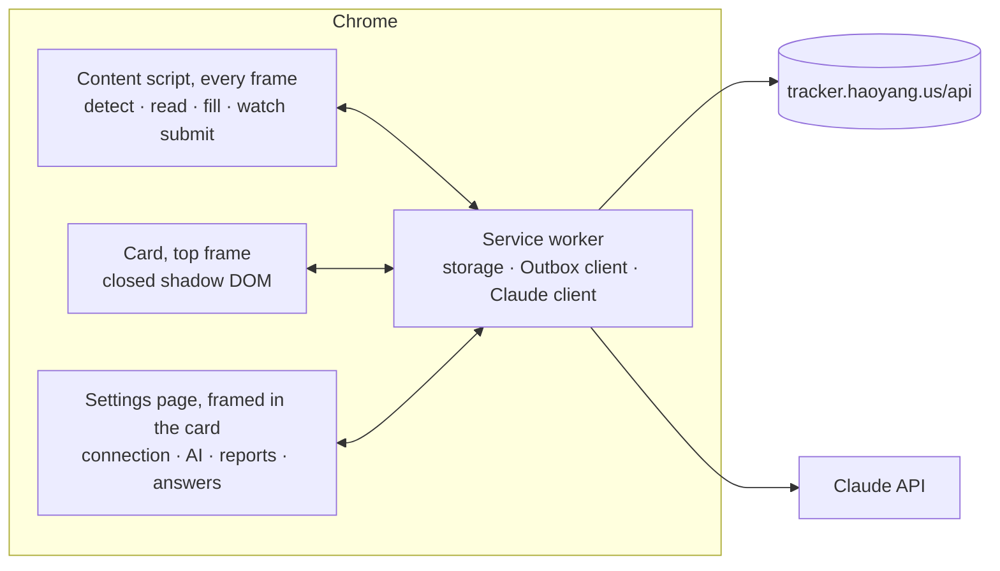

# Outbox Autofill — Design

A Chrome extension that fills job applications from a profile the owner edits on Outbox and logs every submission
to Outbox. Status: decided and built 2026-09-27, in one release without an MVP. What still waits on the owner is in
[todo.md](todo.md).

## 1. Goals

- An application takes 30–60 seconds: open the form, pick the account, press Fill, check, Submit.
- Every submission lands in Outbox with its account, channel, resume version and link, without typing it again.
- Answers are accurate. Work-authorization questions follow fixed rules, never a model.

Principles: rules first, AI for what rules can't place; the owner always presses Submit; the profile stays with the
owner's own Outbox account and browser.

Non-goals: submitting on the owner's behalf; finding postings or applying in bulk; evading bot detection (simulated
typing, fingerprint spoofing, CAPTCHA solving); automating LinkedIn, whose terms forbid it; storing portal passwords
(Chrome's password manager does that).

## 2. How it's used

1. Open an application page. Once the form is on the page, a glass panel slides in down the window's right edge
   (on a window under 1360 px wide it stays a card in the top-right corner): the posting's title with a dot for the
   match check (green, yellow, red; yellow and red give their two main reasons under it), then the accounts, as a
   list with a highlight on the one applying that slides to the next choice — accounts that already applied to
   this posting are disabled — and the resume in use, which drops open to the other versions when pressed. Under
   them, whose profile the form is filled from and how many of the blanks most forms ask about it still has;
   pressing it opens the profile in a window over the page, to edit it right there. A posting whose form isn't
   showing yet gets a card in the top-right corner instead, for its match check and two buttons: **Save for
   later**, which adds it to Outbox as a saved job, and **Mark as applied**. A posting Outbox already saved says so
   when it's opened again.
2. Press **Fill** (or the shortcut). Recognized fields fill in about a second and the resume PDF is attached; the
   button turns into a bar that fills meanwhile. Its count is paced by the stage the fill is at (reading the page,
   then filling), not measured field by field.
3. Work through what the panel lists. It says how many of the form's required fields are filled, over a bar, and
   then names every field with a mark for whether it holds something, grouped by what's left to do: **To fill**
   (nothing to put there; "Required" where the form won't go through without it), **To check** (work-authorization
   answers, consents, AI drafts), **Filled in**, and **Optional, left empty**. Each question reads in full, with
   its answer beside it or the start of its draft under it; pressing one scrolls to its field and leaves the
   highlight on it.
4. Press Submit on the page.
5. The extension sees the confirmation and logs the application to Outbox. The card shrinks to that one line, with
   Undo. Steps 2 and 3 can be skipped: a form filled in by hand, by the site from a resume or by another tool is
   logged the same way once the owner has sent it.

The card shows only what applies. At most one notice sits above its controls, with what to do about it: sign in to
Outbox, fill in the profile, add an API key. What's needed now and then — logging by hand, "This page didn't fill
right", the settings — is in its ⋯ menu.

Workday runs over several pages: Fill once per page. It draws each page's fields a while after the page loads, so
the card opens when they appear. On its sign-up page the extension fills the email and Chrome generates and saves
the password. On LinkedIn the card leads with **Log to Outbox**, since Easy Apply happens right there, with Save for
later beside it. On other sites the card opens by itself on a form
with a resume upload and a name or email field — not on a job board's own apply flow, such as LinkedIn's or Indeed's
— or from the toolbar, and fills what the field dictionary recognizes. Closed, the card stays closed on that page;
the toolbar button brings it back. Where it lies over something the owner wants to see, its – button puts it aside:
the page has that place back, and Outbox's mark stays at the window's right edge as a tab that brings the card back
as it was left. So do the toolbar button and the shortcut, and a log, which the card comes back to say; a form the
page shows next doesn't.

## 3. Architecture

- **Content script** in every frame of the known applicant-tracking hosts. Every other site gets a 6 kB detect script
  instead, idle until the page shows a form with a resume upload (`resumeForm`; at a job address, a React page without
  a `<form>` tag counts too, read around its resume upload); the service worker then injects the content script into
  that frame and the card into the top frame. Each frame reports a form once per address (and Workday step), when it
  has fields (`watch.ts`). The service worker never injects the script twice into one frame, since WXT would stop the
  running copy, card and all. Greenhouse, Lever and Ashby forms are often embedded in an iframe on a company's own
  career site, so the form's frame and the card's frame can differ.
- **Card** in the top frame, in a closed shadow root, which keeps the page's CSS out and its scripts from looking
  into the card or pressing anything in it ([what they still learn](#9-privacy)): a panel the window's height for an
  application, a card for a posting or a log, both pinned to the right edge from the top (the bottom of a page
  belongs to its Submit button, chat bubbles and reCAPTCHA's badge). Put aside, it slides out past that edge and
  stays drawn there, hidden, so it comes back with its list where it was scrolled to; presses on its place go to the
  page; and `card:open` says whether the owner asked for the card (`asked`), since a form showing on the page opens
  a closed card but leaves one put aside where it is. Its element goes back into a page that drops it
  with its own markup (`keepInPage` in `ui/card/shadow.tsx`): where what a server sent doesn't match what the page's
  React draws, React throws the document away, `<html>` and all, and builds another — Greenhouse's boards with a font
  of their own do, a moment after loading — so the watchers observe the document, not its root element. Outbox's
  Liquid Glass over the page, tinted more heavily than in Outbox so text stays readable whatever scrolls beneath, in
  black, white and grays after OpenAI's interfaces, with color only where it says something (the match check, an
  account, an error). Light or dark goes by the page it sits on rather than the system (`scheme.ts`): a dark pane
  over a white page turns the gray of neither. A list's highlight slides to the item chosen on a spring (`Track` in
  `Card.tsx`); nothing follows the pointer. English and Simplified Chinese.
- **Service worker** holds the storage, talks to Outbox and to Claude, and queues logs while offline.
- **Shared code.** The extension imports `src/domain` — link parsing (`postings.ts`), types, rows — so "already
  applied" means the same thing in the extension and the app.
- **Code** lives in `extension/`, an npm workspace built with WXT (Vite), React 19, Tailwind v4 and strict TypeScript.
  It is installed unpacked (Developer mode); it is not published to the Chrome Web Store.

## 4. Profile

Edited on Outbox in its own panel, opened from the profile button in the toolbar (decided 2026-09-27, replacing the
earlier local JSON file): a list of sections beside the form on wide screens, collapsible sections on phones, and a dot
on the toolbar button and on each section while something most forms ask for is still empty. Stored with the owner's
account in D1 as one JSON document (`profiles` table), validated by the shared schema in `src/domain/profile.ts` on
every save. The panel can import the old `autofill-profile.json` once. The extension copies the profile into
`chrome.storage.local` whenever it reads a page or fills, so filling works offline from the last copy. The API key and
remembered answers stay in the extension; they never go to Outbox. Nothing is in git.

**From the card** (decided 2026-10-06). The same profile opens in a window of the card's own, over the application
page (`ProfileSheet.tsx`), so a blank met on a form is fixed without leaving it: eight sections down the left —
Personal (name, contact, address, links), Work authorization, Education, Work experience, Skills, Equal employment,
Common questions, Writing material — and the open one's fields beside them. It loads Outbox's copy (this browser's
when Outbox can't be reached, with a note that nothing can be saved then) and saves through `PUT /api/profile`,
checked by the same schema first in the window and again in the service worker (`background/profile.ts`); a save
Outbox didn't take isn't kept locally either, or the next sync would quietly undo it. Entries added and left blank
are dropped on save. Reading a resume into the profile stays on Outbox's page. What has a list is picked from it:
pronouns, the US state, the work status (which sets the OPT field with it, so the two can't disagree), the languages
(several, folded behind what's chosen), and "Present" for a job still held, as a choice of its own rather than an end
date left empty.

**Settings** (decided 2026-10-06) open from the card's ⋯ menu in a window like the profile's, not in a tab. What's
in the window is the extension's own page (`entrypoints/options`) in a frame (`SettingsFrame.tsx`): what's typed
into the card's own markup still passes the page under it, closed as its shadow root is ([Privacy](#9-privacy)):
no place for an API key. Nothing crosses a frame of the extension's origin. The settings' page is reachable by
address from any site, so framed it draws only on a ticket the card asked the service worker for, for its tab, good
once (`background/settings.ts`); in a tab of its own (the browser's "Options") it draws as it is. Five sections —
Connection (Outbox, the profile's and resumes' copies, Outbox's address), AI, Fill reports, Remembered answers,
General (language, the same-company warning, export and delete) — each saving as it's changed. The window appears in
place rather than gliding in: Chrome drops presses on a frame from another origin while it moves and for half a
second after. Where a page won't show the frame, the settings open in a tab after 6 s. Outbox's own page asks for
the settings too ("Open extension settings", in its toolbar and its setup guide), and since 2026-10-07 gets the same
window over itself, with no card under it (`ui/card/settingsWindow.tsx`), where the settings used to take a tab. As
the window closes the page is told again how the extension is doing, so a key just added shows there at once.

**Resumes** (decided 2026-09-28, replacing PDFs added on the options page) are uploaded on Outbox, on their own page: one PDF per resume version, up to 1.4 MB, stored in D1 as base64 (`resume_files`, apart from the
version so the snapshot never reads it). Base64 rather than a blob: D1 hands a blob to the Worker as an array of
numbers, which costs more CPU than the free plan allows, and a row holds at most 2 MB. `GET /api/resumes/:id/file`
serves the PDF itself, so the panel opens it with a plain link. The card lists the versions that have a PDF; on Fill
the extension downloads the one picked and keeps a copy in its IndexedDB, replaced when Outbox's is newer, so filling
works offline. Uploading is the start of everything else: the extension attaches the PDF, logs record its version,
and the profile is read from it.

**From a resume.** A new profile starts from the resume, as Simplify and similar tools do. "Fill from resume" picks
one of the stored resumes (or uploads a new PDF, which becomes a version too), and "Fill profile" on a resume in the
resumes page opens the profile page reading it. The setup guide's fourth step reads one the same way. The page hands the PDF to the extension through its content script on Outbox (`src/domain/bridge.ts`, `window.postMessage` limited to
the page's own window and origin); the service worker reads it with the owner's key (Claude, structured output into
`resumeFactsSchema`) and hands back only the facts. The panel then lists what would change for the owner to pick
from: contact details and links fill only empty fields, education and work experience are replaced, new skills and
languages are added, and the summary fills an empty one (`applyResume`). Nothing is saved until Save. Work
authorization, EEO and the common answers are never taken from a resume. A read costs a few cents; without the
extension, or without its key, the panel says what's missing.

| Section            | Contents                                                                                                  |
| ------------------ | --------------------------------------------------------------------------------------------------------- |
| Identity           | Legal first and last name, preferred name, pronouns                                                       |
| Contact            | Phone, address, city, state, ZIP, country. The email comes from the account picked on the card            |
| Links              | LinkedIn, GitHub, website                                                                                 |
| Work authorization | Authorized to work in the US; sponsorship needed now; needed in the future; current status (F-1 STEM OPT) |
| Education          | School, degree, field, dates, GPA (optional)                                                              |
| Experience         | Company, title, location, dates, description — Workday asks for each entry                                |
| Voluntary (EEO)    | Gender, Hispanic/Latino, race, veteran, disability, sexual orientation; "decline" allowed for each        |
| Common answers     | How you heard, earliest start, salary expectation, relocation, on-site, previously employed, age 18+      |
| Writing material   | Summary, STAR stories, approved snippets — grounding for free-text answers                                |
| Resumes            | Not in the profile: PDFs uploaded on Outbox, one per resume version (see above)                           |

## 5. Filling

Each field goes through four layers and stops at the first that places it:

1. **Applicant-tracking adapter** — Greenhouse, Lever, Ashby, Workday. Finds the fields and drives the widgets a plain
   value can't set: react-select dropdowns, Ashby's yes/no buttons, Workday's dropdowns, typeaheads and repeatable
   work and education sections.
2. **Field dictionary** — label patterns mapped to profile keys. Works on any site.
3. **Answer memory** — what the owner typed into a field the layers above missed, keyed by the normalized question
   and reused next time. Captured at submit; listed in the settings, where an answer can be taken off. It also
   fills one of the form's own fields (Greenhouse's "Preferred First Name") when the profile has nothing for it.
4. **AI fallback** — the remaining fields, as text (label, kind, options), go to Claude in one request per form.
   Below a confidence threshold the field stays blank.

**Critical questions are rules only**: authorization to work, sponsorship (now, in the future, either, and negated
wordings like "do you not require…"), citizenship and visa status. They never reach the model; an ambiguous wording
stays blank and turns red; every answer is marked for confirmation.

After filling, the card lists every field the form has (`checklist` in `background/card.ts`), each with a mark —
a check where the field now holds something, a dash where it doesn't — and its answer: what needs the owner first
(to fill, then to check, AI's drafts marked **AI**), then what filled fine, then what was optional and left alone.
The count over the bar is of the fields the form marks as required, or of all of them where it marks none.
Clicking an entry scrolls to its field. Values are set so React sees them: the native value setter plus `input` and `change`
events, clicks for radios, checkboxes and options, and a `DataTransfer` for the resume's file input.

The list follows the page after the fill (2026-10-07), since the owner goes on by hand: a question they answer
moves to the filled ones with its answer, a field they empty goes back to theirs to fill, and the count over the bar
moves with them. Each frame's content script looks at its fields a moment after the page changes (`watchHeld` in
`content/held.ts`: `input` and `change` events for typing, a mutation observer for what a custom dropdown draws) and
tells the service worker what each holds whenever that differs from what it last told (`frame:held`). The service
worker keeps each frame's latest look in the tab's session and sends the card its list alone (`card:checklist`),
asking Outbox for nothing. Of a look at a field and the fill's own result for it, the later counts, by the page's
clock; while the script itself fills it doesn't look. Where it can't tell, a field keeps the standing the fill gave
it: a widget that draws its value its own way and shows none, an upload with no file to see (the page may have taken
the file and emptied the input), a control the page has since replaced. Gem's uploads it can tell: there the page
names the file it holds, and no name is no file (see Gem below). A react-select holds a pick when it shows
one or its value box says so (it stops drawing the pick while something is typed over it); what's typed into its
search box isn't one. Tried on Greenhouse's own page code served locally, as the waits below were.

What the page already holds stays, on the first fill and on any later one: what the site read from an attached
resume (the resume goes in first and the fill waits for the site, see below), what the owner typed or picked. Filling
again redoes the extension's own answers, so that another account, resume or an edited profile takes effect, but only
while a field still shows what the extension left in it (`wrote` in `content/main.ts`): an answer the owner corrected
is theirs from then on (their call, 2026-10-07), and so is one the site wrote over. A field emptied is filled again,
a box unticked counts as emptied, and the email always names the account picked on the card. Two kinds of its own
answers aren't redone while they stand (also 2026-10-07). What AI wrote is asked for once: the scan marks a field
still holding it as `drafted`, the plan keeps AI's line for it, and only a field emptied since is asked for again;
before, every fill asked for every draft anew and wrote over the last. And a resume already attached isn't attached
again unless another is chosen on the card: put in again, the site takes the file in again, and one that reads
resumes reads it again (on Lever's own page code that took a second fill from 1.0 s to 2.1 s). A dropdown's pick is
looked for in the dropdown's own box (`pickBox` in `content/extract.ts`). Until 2026-10-07 it was looked for in the
wrapper round the search input, which react-select calls a container too, so on Greenhouse's own pages a dropdown the
owner had answered read as empty: a fill wrote over it, and the answer wasn't remembered at submit.

For ordinary answers too, a repeated fill now skips a field when both the requested answer and the value the
page shows are unchanged. This avoids reopening dropdown searches and triggering the site's saves again. A
changed profile or account still updates the extension's own answer; an emptied field or one whose value cannot
be read is tried again. The content-script tests check page change events, and the browser test checks that
repeating a Greenhouse fill does not search again for an already selected city or school.

An answer can bring up another question (Greenhouse asks for race once "Hispanic or Latino?" is answered), so after
filling the page is read again and what appeared is filled too, twice at most; a field keeps its id across reads.
Ashby saves each answer to its server as it changes, and saves that overlap there overwrite each other — a form
filled all at once showed every answer and still reported some missing on submit — so on Ashby fields are filled one
at a time, each save finished (seen in the page's network timeline) before the next.

A page the browser translates is read in its own words (2026-10-08, after a report from an Ashby form that turned
Chinese while it was being filled). Chrome's page translation puts its words where the page's stood: each text in two
nested ``s, placeholders and the title too, in the document and in open shadow roots. It leaves what is marked
`translate="no"`, closed shadow roots (the card's) and frames of another site, and it marks the document
(`translated-ltr` on `<html>`) from before the first word changes for as long as the translation stands; what the
page draws later is translated a moment after it is drawn. The rules read English, and a choice is planned by its
wording, so a form translated between its reading and the fill lost every choice still to go in ("no matching
option", the report's race and veteran status), and one translated before Fill lost the questions only a label names
as well: sponsorship and "have you worked here" came out unknown, which is what goes to the model. So the content
script keeps the page's words (`content/words.ts`): a field read once untranslated is given back in those words,
label, description, choices and section, in every later reading taken while the document carries the mark, and so is
the posting for as long as its address is the same. A choice goes into the control standing where the planned one was
read (`choiceAt` in `content/apply.ts`): the controls stay as they were, and only read otherwise. And what the owner
answers is remembered in the page's words (`readAnswer`). The words aren't kept from one step of a form or one address
to the next, nor for a control that comes to read otherwise a second time or has another number of choices, since a
page may draw another question in the same control.

That leaves a form translated before it is first read, which has only the translation to go by: one drawn into a
page already shown translated is reworded within a tenth of a second (words the page has shown before, within a
hundredth), and the card reads it half a second on. So the form is kept out of the translation (the owner's choice,
the same day: the form stays as the page wrote it, and the rest of the page is translated as they asked).
`leaveUntranslated` in `content/words.ts` puts the page's own mark, `translate="no"`, on the adapter's form in the
turn it is drawn in, on applicant-tracking hosts; on any other site finding the form takes a look over the whole
page, so there it is marked each time it is read. And while the extension itself works the page, filling it or
reading a dropdown's choices, the mark is on the page's body too (`holdTranslation`): the lists a fill opens are
often drawn at the end of the page, outside the form. Once the body's mark comes off, the translation takes up what
it skipped, by itself; the form's stays on. The page's words kept above are then for what was translated all the
same: a form the browser had translated before the extension came to the page. What a page says once the form is
sent is no part of the form, and is translated like the rest of the page wherever it isn't drawn inside the form's
own element: [Logging to Outbox](#8-logging-to-outbox) says how it's read all the same.

Tried on Ashby's own page code served locally, with Chrome's own translation switched on in the specs' browser (which
sends the made-up page's text to Google, so that run isn't one of the specs): the translation arriving in the middle
of a fill, before one, and before the form is drawn, each followed by "Fill again"; and on the saved Lever,
Greenhouse and Gem pages, whose forms are in the document from the start and were marked before the translation's
first pass, some 0.9 s after the page was asked for.

The card's two choices are told apart (same day, same report): choosing an account took the resume out of the tab's
session, the card's message naming one of the two and the service worker reading it as naming both, while the card
went on showing the first resume. The next Fill then planned the resume as missing and attached none, until the tab
was read again. `select` in `background/card.ts` changes the one that was chosen.

In two places the fill waits for what the page does rather than for a set time (decided 2026-10-07, each tried
first on the site's own page code served locally; that code isn't in the repository). A react-select dropdown, which
is what Greenhouse's are: its list is looked for again at once, and after a pick the fill goes on as soon as the list
has closed, which it has by its next render, where it used to wait 150 ms. That took a second or two off a form
of a dozen dropdowns. Any other dropdown, Workday's and Ashby's among them, keeps the pace and the 150 ms it had:
there's no page of theirs to try shorter waits on. And Lever's resume: after it's attached the fill goes on when
Lever's "Analyzing resume..." gives way to how it went, eight seconds later at most; it used to wait 2.5 s whatever
Lever did, so a read that took longer was typed over. A Lever page that shows no such note gets the 2.5 s, and so
does Ashby, whose page says nothing of when it's through. Gem's uploads have a wait of this kind too: a file is
attached once Gem names it (below).

| System     | Hosts                                                          | Notes                                                      |
| ---------- | -------------------------------------------------------------- | ---------------------------------------------------------- |
| Greenhouse | `job-boards.greenhouse.io`, `boards.greenhouse.io`, EU, embeds | react-select dropdowns; embeds read the job from page data |
| Lever      | `jobs.lever.co`, EU                                            | Plain HTML form; a thank-you page after submit             |
| Ashby      | `jobs.ashbyhq.com`, embeds                                     | React; yes/no buttons; posting from `window.__appData`     |
| Workday    | `*.myworkdayjobs.com`, `*.myworkdaysite.com`                   | One Fill per page; built from `data-automation-id` names   |
| Gem        | `jobs.gem.com`                                                 | React, no `<form>`; fields named by the text beside them   |
| LinkedIn   | `linkedin.com/jobs`                                            | No filling: Log to Outbox                                  |
| Other      | Any                                                            | Dictionary only; card opens on a form with a resume upload |

**Gem** (added 2026-10-07, after the card stayed away from an 11x posting) draws its form without a `<form>` tag, and
its controls carry no name, id, label or `aria-label`: a question is a block with its text in one element and the
control after it. Nothing generic could tell that page for an application or name a field on it, so Gem has an adapter
(`adapters/gem.ts`) that reads every field from its block — text and long text, radios and checkboxes (which share no
`name` there: the block is what groups them), uploads, a 1-to-5 rating drawn as buttons, and dropdowns. A dropdown is
a bare button whose list is drawn at the end of the page while it is open (floating-ui): a list box for a posting's
own questions, a `menu` of menu items for the voluntary questions. Text shown between questions has no control and is
no field. The company comes from the posting data the page writes for search engines, else from the board's name in
the address ("11x Ai" for 11x.ai); the page writes that data a moment after it draws the form, so the form's frame
tells of its form once more when the data has come, and the card reads the page again (`postingLate`). Gem has two
buttons that send an application, "Apply and save" and "Apply without saving", and its confirmation takes the form's
place on the same address. Its class names are a component's rule name and a counter (`bodyImportant-47`), so the
adapter matches the names. Tried on Gem's own page code served locally with a stand-in for its API, on a made-up
posting holding each of its fields and kinds of question: Fill, the owner's own changes kept by "Fill again", and a
press of its button through to the log.

An upload on Gem holds the file Gem names over its box, which isn't always the one in its input (2026-10-07). The ✕
beside the name makes Gem forget the file and leaves it in the input; a file the owner drops onto the box, or picks
in the dialog the box opens, goes into Gem's own state and never reaches the input (in Chrome the box asks the
browser for files itself). Read by its input, a resume taken out at the ✕ went on showing as attached on the card
and "Fill again" attached nothing, while Gem's own Apply answered "Please upload a resume."; and a file put in by
hand showed under the earlier file's name, or under none. So on Gem an upload's handle reads the page (`shown` on a
file handle; `heldFile` in `content/extract.ts` asks it before the input): the scan, the list and "Fill again" go by
the name Gem shows, and no name is no file, so the list asks for the resume again and "Fill again" attaches it
again. A file counts as attached once Gem names it, which takes it a few milliseconds and is waited for two
seconds at most; one Gem doesn't come to name is reported as not taken. A file the owner put in by hand is theirs,
as on any other site: the list shows its name, and it stays when another resume is chosen on the card (Gem's ✕
makes room for the card's). Tried on Gem's own page code as above, the unfixed build beside the fixed one: ✕ and
"Fill again", another resume and back, a file dropped onto the box, one picked through the box's dialog (the
dialog itself stood in for), a cover letter put in and taken out, and Gem's Apply refusing a form without a resume.
A first fill and a repeated one took as long as before on a posting of nine fields (1.37 s and 0.85 s from the
card's bar coming up to its going, six runs each, headless Chromium). A saved Gem page has none of Gem's code, so
an attach replayed on one waits its two seconds and reports the file as not taken: the specs put a stand-in for
that code into the page.

**The job's country** comes from the posting's location: a US state or city anywhere in it means the US ("San
Francisco; London"), otherwise the country or large city abroad it names ("Belgrade" is Serbia; "Dublin, CA" stays
American). It decides the "authorized to work in the country where the job is located" questions, and marks
relocation and office questions for a job abroad as the owner's call.

**The applicant's own country** — where they live, and the countries they expect to work in — is typed as the
profile spells it, and taken from a list under whichever of its names the list has: "United States of America",
"USA" or "US", "UK" for the United Kingdom, "UAE" for the Emirates. A group of boxes takes such an answer as a
dropdown does (2026-10-08): one box, found while planning, and with no box that carries it the question is the
owner's to fill, or AI's. Until then the plan held the profile's spelling and counted the question as filled, so on
Stripe's form, whose boxes say "US", none was ticked. Tried on Greenhouse's own page code served locally, with a
second fill and boxes changed by hand.

**When a page fills badly**, "This page didn't fill right" in the card's ⋯ menu saves the form's structure — labels, kinds,
options, what each layer did — without any values. Those snapshots become test fixtures. Workday's adapter is built
from its `data-automation-id` conventions, not from a saved form, so its first real pages are the ones to snapshot.
The snapshots, listed in the settings under "Fill reports" with the posting each came from, are the list of open
problems: pressed again on the same form, the newer snapshot
takes the older one's place, and a snapshot leaves the list when a build that fixes it is loaded — its id goes into
`src/background/fixed.ts` with the fix.

Emptying the inputs doesn't take every value out of a page that keeps answers in markup of its own, so an adapter
can finish the job on the snapshot's copy of the form (`blank`). Gem's does (2026-10-08). There a dropdown is a
button that reads its pick, a radio's circle, a checkbox's box and a rating's number are drawn in the look of the one
taken, a long answer is repeated on the box that grows with it (`data-value`), and an attached file is named over its
upload: a snapshot of a Gem page kept all of these, the voluntary answers among them, and lost only what was typed
into a one-line field. Each now goes back to what Gem draws for a question still unanswered — a dropdown to its
prompt (with no text, its button would read as holding a pick), a pressed number to the look of the others, the
file's line gone and its box offering to upload again — and a choice's circle or box is left bare, the same whether
the choice was taken or not. The snapshot of an answered Gem page is then the snapshot of that page unanswered, and
reads back as the same fields with nothing filled in. Tried on Gem's own page code as above: a form answered by Fill
and by hand (text, a long answer, three files, a radio, ticked boxes, both kinds of dropdown, a rating) saves what
the same form saves before any of it.

The other sites were checked the same way the same day, each on its own page code: a report saved before anything
was answered against one saved after Fill and after every kind of control the page has was answered by hand.

- **Greenhouse** (four postings' pages: text, long text, dropdowns that take one pick or several, the city and
  school searches, a checkbox group, two uploads, the voluntary questions) kept two things. The name of each
  attached file, in a line of its own where the upload's buttons were (`file-upload__filename`); and the country of
  the phone number, which intl-tel-input writes on its button as a tooltip, as a label for screen readers and as
  the class of a flag. The snapshot takes both out itself now, with no adapter's help: a file's name wherever a
  class says "filename" (Lever's already was), and what intl-tel-input's button says wherever that library is.
  What react-select repeats of its search box (`data-value`) and tells a screen reader ("option …, selected") is on
  the page only while the dropdown has the focus, and a press on the card takes the focus away: neither was in any
  report, whether the form was the page itself or sat in a frame on a company's site.
- **Lever** (two postings' pages) keeps its answers in plain controls, which a copy of the markup doesn't hold,
  but for the list it draws with select2 (the school): the pick stood in the report as text and again as a
  tooltip. The snapshot empties that too.
- **Ashby** (a made-up posting with one field of each kind its form has, and its voluntary questions) kept the
  most. A pressed Yes or No, by a class on the button (`_active_…`: only `aria-pressed` was reset); a chosen radio
  and a ticked box, by a class on the circle or box and on the label (`_checked_…`), by `data-checked`, and on a
  radio's row by the word "true" — the voluntary questions and the work-authorization ones among them; a rating's
  number; every attached file's name; and a school's dates, which each bound the other's lists, so that the months
  and years left to choose from tell them. Ashby's adapter has a `blank` for these, and the report of an answered
  Ashby page is then the report of that page unanswered, to the character. Ashby's page runs from this machine
  with its shell, its one bundle and stand-ins for the calls of its API that a form makes (`ApiJobPosting`,
  `ApiOrganizationFromHostedJobsPageName`, `ApiSetFormValue`, the three for files, the city and school searches);
  the form comes from the first of those, so a made-up one can hold every kind of field.

A report still tells that something was held, though not what: a dropdown that had a pick (react-select's
`--has-value`, which has told the bug queue more than once that the owner had answered by hand), an upload that held
a file on Greenhouse and Lever, a select2 list whose prompt is gone. And it shows the form as it stood, so a question
that only comes up after a certain answer (Greenhouse's race question once "Hispanic or Latino?" is "No", the box
under "I prefer to self describe") is in the report because it was on the page. Workday couldn't be checked this
way: its forms sit behind a sign-in, so there is no page of its own to serve. Its dropdown buttons, chips and
checked marks are emptied by rules written from the owner's earlier snapshots; whether its date boxes, its uploads
or anything else keep an answer isn't known.

## 6. AI

- Claude is called from the service worker with `@anthropic-ai/sdk` — not through the Worker, so the free Workers
  plan is enough. The owner's API key stays in `chrome.storage.local`; the monthly spend limit is set in the Anthropic
  Console.
- **Model:** Claude Opus 5 by default, Claude Sonnet 5 selectable; the free-text eval decides whether to switch.
  Server-side refusal fallback is on.
- **Or an OpenAI-compatible endpoint** (added 2026-09-28, and the default since): OpenAI's chat completions API at any
  address — the owner uses a proxy at `https://api.kabi.pro` (`/v1` is added to a bare address) with GPT-5.6 Terra.
  Its own key, also only in `chrome.storage.local`. Structured output goes as a strict `json_schema`, a resume as a PDF
  `file` part; a proxy that refuses `max_completion_tokens` or structured output gets the request again without it.
  Token counts are recorded, cost isn't: the proxy's prices aren't known. The free-text eval still runs on Claude.
  The settings offer three models to pick from (`OPENAI_MODELS` in `storage.ts`: GPT-5.6 Luna, Sol and Terra, the
  owner's choice out of all the proxy lists) and a reasoning effort (decided 2026-10-07): "auto" keeps each request's
  own (low to answer leftover fields and read a resume, medium to draft), or low, medium or high for all of them,
  sent as `reasoning_effort`. Thinking is paid for in output tokens, so a request made with more effort than it was
  sized for gets more room in step (`roomFor` in `background/ai.ts`), up to the largest limit a request already
  uses. An endpoint that refuses the parameter gets the request again without it, and the settings' key check says
  so.
- **Field fallback:** one structured-output request per form listing the unplaced fields; each answer comes back with
  a confidence.
- **Free-text drafts** ("Why this company?") are grounded in real material: the resume, STAR stories, approved
  snippets, and one specific detail from the posting. Style rules keep them short and plain (no "passionate",
  "thrilled", "leverage"…). The owner's edited finals become examples for later drafts. Optional questions are
  skipped by default.
- The field request and the drafts go out together, three at a time at most, and their answers go into the page
  one at a time as they come back (decided 2026-10-07: each takes seconds, and they used to wait for one
  another). One that fails among the others gets a second go alone, since a proxy may turn a crowd away; one that
  fails twice ends the AI's part with its error, and what the others drafted stays.
- Page text is data, never instructions, and critical questions never reach the model.
- **Cost estimate** at 30 applications a day: about $20 a month on Opus 5, under $10 on Sonnet 5.

## 7. Match check

Shown before filling. It warns and never blocks.

| Signal                                                                                            | Level  |
| ------------------------------------------------------------------------------------------------- | ------ |
| US citizenship, security clearance, export-control "U.S. person", or an explicit "no sponsorship" | Red    |
| 5+ years required; Senior, Staff, Principal, Lead or Manager titles                               | Yellow |
| Three or more postings at this company in the last 30 days (from Outbox)                          | Yellow |
| New-grad or early-career signals, H-1B history                                                    | Green  |

H-1B history is a compact table built from the USCIS H-1B Employer Data Hub files for fiscal years 2021–2023 (82,000
employers, bundled with the extension) and matched by normalized company name. A company with no approvals on record
raises nothing: the match is by name, and most small employers aren't in the table.

**Duplicate hint.** Ashby and Workday merge candidates by name and contact details, so picking a second account for
a posting there shows a note. It is a note, not a block.

## 8. Logging to Outbox

- On a detected submission the service worker sends a quick add: company, title, link, the existing job when the
  link or company and title match (`findSamePosting`), the account, channel "Company site", and the resume version.
  The card shrinks to "Logged to Outbox" with Undo (`/quick-add/undo`). While offline the log waits in a queue.
- **What counts as a submission** (`content/submit.ts`, `submitConfirmed` in `background/card.ts`): the owner's press
  of the form's Submit seen in the tab — its button, or the form's own submit event — and then, within fifteen
  minutes, a page saying the application went through: the same page, or the one the form leads to. Who filled the
  form in doesn't count (since 2026-10-08; until then only a form this extension had filled was logged, so one the
  owner filled in by hand, or the site from a resume, or another tool, went unrecorded). With the fill no longer
  asked for, the form sent is what tells an application: another form on the page, a search box or a sign-up, is
  none, though the page is still watched for what it says after it. Where no press was seen, a confirmation at the
  posting's own address is still logged for a form the extension filled, and for no other: such a page can be opened
  without applying.
- A board that moves between postings without loading a page has each application told of in its turn: a document
  tells of a confirmation once, and of the next when another form is sent from it after that confirmation has left
  the page (until 2026-10-08 it told of one and no more, so a second posting applied to in the same tab went
  unrecorded). Not seen at all: a thank-you on a page that doesn't run the content script, which on a site without
  an adapter is any page but the one with the form, so one that takes that page's place in the tab; and LinkedIn's
  Easy Apply, whose card has the Log button.
- **How a page says so** (`confirmed` in each adapter). By its address, where the system has one for it:
  Greenhouse's `/confirmation`, Lever's `/thanks`, and Workday's `/jobTasks/completed/application`, where someone
  signed in is taken once the application is in. By what takes the form's place: on Ashby the box its code draws
  there (`ashby-application-form-success-container`), whose words are the company's to choose. By its words
  otherwise: Gem's "Your application for … has been received" in the form's box, the note Workday draws for someone
  applying without an account, a thank-you on a site without an adapter. Words are the weakest of the three
  (2026-10-08). They hold for one language and one wording, and a page the browser translates has them reworded
  between 70 and 170 ms after it draws them, while the page was looked at every 600 ms: on a careers page whose
  thank-you takes the form's place, with Chrome's own translation on, 2 applications of 12 were logged, the two
  whose thank-you came just before a look. So after a form is sent the page is also read in the turn it draws
  anything in (a `MutationObserver` in `content/submit.ts`; a look takes 0.03 to 0.4 ms on the saved pages), while
  the words are still its own: 12 of 12. A thank-you drawn inside the form's own element is under the form's mark
  and isn't translated at all, which is why Ashby's and Gem's were recognized on a translated page before this, on
  their own page code served locally. Ashby's wasn't where the company had written its own, translated or not: it
  was told by Ashby's default words. Read that soon, a confirmation can reach the service worker right behind the
  sending it is logged by, where it used to come at least 600 ms after. One just woken by the two took the
  stored session for the newer and lost the sending, so nothing was logged: the content script now tells of a
  confirmation once the sending has been answered, and a session read while another flow changes it is the changed
  one (`getSession` in `background/session.ts`).
- **Workday** ends an application on another page than its form's, which wasn't known until 2026-10-08. Its page
  code (`candidate-experience-apply-flow` on its CDN, read that day) takes someone signed in to
  `…/jobTasks/completed/application`, a page that loads empty and is drawn by script after that, in the page's
  language: after the one look the content script takes of a page it starts on, so a confirmation there was never
  seen, and the dialog the adapter had looked for isn't in the code of the form's pages. The address tells now.
  That page names no posting, and the card reads every page it comes up on: read as another posting's, it took
  the log and its Undo off the card whenever that reading came after the log, and left the buttons of a posting
  without a name. So the page a confirmation was told on stays the application's (`confirmedOn` in the tab's
  session, kept by `readTab` while the page names no posting of its own). The press that sends the application
  is told without its word too: the one button at the foot of every step (`pageFooterNextButton`) sends it on the
  last, the step the progress bar shows none after (`progressBarInactiveStep`), and says "Submit" only where
  Workday is in English, while some of the owner's Workday forms came in Chinese. The button and the bar are
  inside the element kept out of the browser's translation. All of this is read from Workday's code and tried on
  stand-ins drawn after it, not on an application: its forms sit behind a sign-in, and what the page after it
  says wasn't seen.
- **Which account.** The one whose email the form held as it was sent, whichever the card had chosen: the owner may
  have typed another's, or the site or another tool put one there. The emails are read from the form at the press
  of Submit (`emailsIn`), not from an earlier reading of it, which a page that has drawn its fields anew since would
  leave behind. The card's choice stands where the form holds no account's email or more than one's, and for a log
  made by hand from the card. The resume version logged is the card's.
- **Save for later** on a posting sends a quick add with no account, which Outbox shows as a saved job, with Undo
  the same way. The first log with an account is remembered (`local:logged`): Outbox's setup checklist asks the
  extension, over the page bridge, whether it has logged an application yet, along with its version and whether it
  can read resumes. The bridge also shows the extension's settings when Outbox's page asks, for the API key: in
  their window over that page ([Settings](#4-profile)).
- **Sign-in:** requests carry Outbox's session cookie (the extension has host permission). If Chrome doesn't send it,
  a content script on the Outbox tab reads the session token from `/api/auth/get-session`, and the service worker
  sends it as a bearer token (Better Auth's `bearer` plugin). If both fail, the card asks the owner to open Outbox.
- In development the extension can point at `http://localhost:5180`, where the dev bypass signs requests in.

## 9. Privacy

The profile and the resume PDFs are stored in the owner's own D1 database behind Google sign-in limited to their
account, and copied into the browser that fills. Remembered answers and the API key stay on the machine; a resume PDF
goes to the model only when the owner asks the profile panel to read it. Claude receives field labels and options, the profile parts a question needs, and the posting's text for
drafts — never voluntary (EEO) answers or work-authorization questions. Form snapshots carry no values.

**What the page can reach** (decided 2026-10-07). The card sits in the page it helps with, and that page's scripts
are anyone's: the career site's own, its analytics, a session recorder that takes down open shadow roots with the
rest of the page. The card shows the accounts and the resume versions, its profile window every field of the
profile — more than any one form asks for — and its buttons fill, log and save. So its shadow root is closed, and
made by the content script, on the extension's side of the page, where a page that swapped `attachShadow` for its
own changes nothing (`ui/card/shadow.tsx`): the page finds the card's element and nothing in it, and a press it makes
up stops at that element. The settings' frame is inside too, where the page can't point it somewhere else. One way
round is shut separately: an element's definition is handed the element's shadow root whatever its mode
(`ElementInternals.shadowRoot`), so where a page defined an element named `outbox-autofill` before the card came,
no card is drawn; a definition made afterwards gets nothing.

A closed root keeps markup in, not everything. A page written to look still gets the keys typed and the text
pasted into the card (those events pass the page's window on their way in), the text selected in it (tabbing into
a field selects what it holds), and whether a given string stands in it, a field's value included (`window.find`
searches the card as find-in-page does); it also sees where the card is, and can cover it or remove it. None of
that presses anything or changes the profile: the most a page can do there is draw over the card and wait for the
owner's own press. And all of it takes a script written against this extension. What such a script would learn is
what the card shows while it shows it, most of which the owner is about to hand that page's form: so the profile's
window stays in the card, with its glass and its glide. The API keys don't: the settings are a frame of the
extension's own origin, which none of this crosses. Should the profile ever have to be kept from a page that goes
looking, its window goes into that frame as well, and appears in place as the settings do.

## 10. Testing

- **Unit** (Vitest, happy-dom): the dictionary, the critical-question rules, the match scan, the setters, each adapter
  on fixtures, submission detection.
- **Fixtures:** 22 public application pages saved as served — 10 Greenhouse (4 of them embedded on a company's
  site), 6 Lever, and 6 Ashby rendered in Chromium — and one page each that Gem's and Ashby's code drew from a
  made-up posting with each kind of question they have, plus 646 questions from about 115 public postings, whose
  answers are snapshot-tested. Workday's forms sit behind sign-in, so they come from the owner's snapshots.
- **Fill accuracy** — answers correct over answers expected, and required fields filled, per system — is reported,
  gated in CI, and quoted in the README. Every expected answer was checked by hand. With rules only: Greenhouse
  172/172 (87% of required fields filled), Lever 115/115 (79%), Ashby 78/78 (77%).
- **End to end** (Playwright): the built extension in Chromium against fixtures served on the real hosts through
  request interception, logging to a mock Outbox: Greenhouse, Lever and Gem fill → submit → logged, Ashby fill;
  a Greenhouse form filled in by hand → submit → logged under the account its email names, and two postings
  applied to from one document, each logged;
  an application logged though its thank-you is reworded a moment after it's drawn (a stand-in for the browser's
  translation, which a spec can't switch on: it sends the page to a translator), an Ashby one the company thanks
  for in its own words, and a Workday one sent in Chinese and told on the page it's taken to;
  on Gem also the resume taken out at its ✕ and attached again, and a file dropped in by hand kept.
  Playwright can't look into a closed shadow root any more than a page can, so the specs drive a build of their
  own: the one Chrome loads with the card's root left open and nothing else changed (`wxt.e2e.config.ts`), made as
  a run starts, in `.output/chrome-mv3-e2e`. One spec (`e2e/reach.spec.ts`) takes the build Chrome loads and tries
  it from the page's side: the card not read and not pressed, the profile not saved, no card where the page
  claimed its element. What's in the card it reads on the extension's side (`chrome.dom`) and presses with the
  mouse.
- **Free-text eval** (`npm run eval -w extension`): each model drafts the same 20 essay questions through the
  extension's own `draftAnswer`, and a report puts the drafts side by side with flags for banned phrases and
  numbers the material never states. A run costs about $1, so the owner starts each one.
