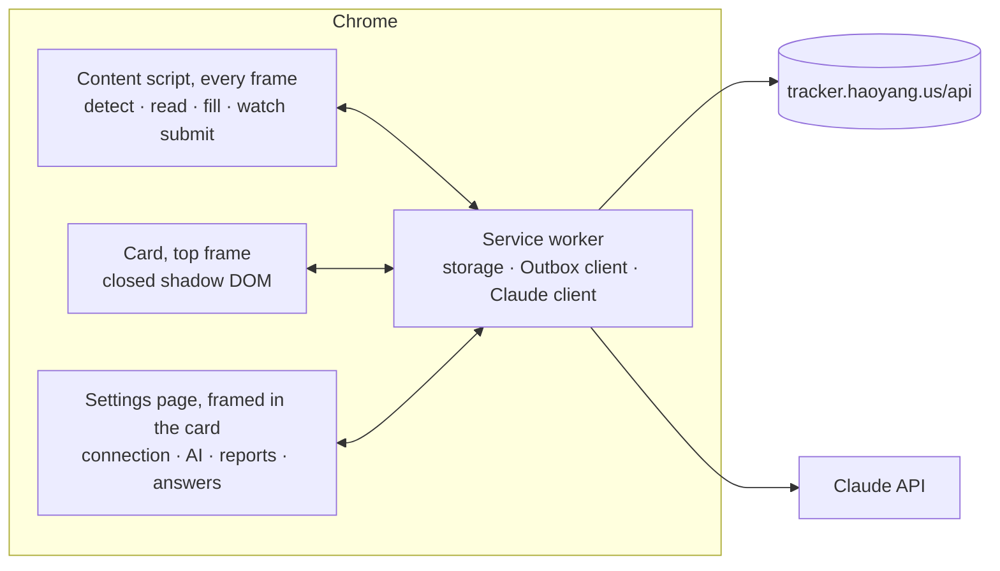

# Outbox Autofill — Design

A Chrome extension that fills job applications from a profile the owner edits on Outbox and logs every submission
to Outbox. Status: decided and built 2026-09-27, in one release without an MVP. What still waits on the owner is in
[todo.md](todo.md).

## 1. Goals

- An application takes 30–60 seconds: open the form, pick the account, press Fill, check, Submit.
- Every submission lands in Outbox with its account, channel, resume version and link, without typing it again.
- Answers are accurate. Work-authorization questions follow fixed rules, never a model.

Principles: rules first, AI for what rules can't place; the owner always presses Submit; the profile stays with the
owner's own Outbox account and browser.

Non-goals: submitting on the owner's behalf; finding postings or applying in bulk; evading bot detection (simulated
typing, fingerprint spoofing, CAPTCHA solving); automating LinkedIn, whose terms forbid it; storing portal passwords
(Chrome's password manager does that).

## 2. How it's used

1. Open an application page. Once the form is on the page, a glass panel slides in down the window's right edge
   (on a window under 1360 px wide it stays a card in the top-right corner): the posting's title with a dot for the
   match check (green, yellow, red; yellow and red give their two main reasons under it), then the accounts, as a
   list with a highlight on the one applying that slides to the next choice — accounts that already applied to
   this posting are disabled — and the resume in use, which drops open to the other versions when pressed. Under
   them, whose profile the form is filled from and how many of the blanks most forms ask about it still has;
   pressing it opens the profile in a window over the page, to edit it right there. A posting whose form isn't
   showing yet gets a card in the top-right corner instead, for its match check and two buttons: **Save for
   later**, which adds it to Outbox as a saved job, and **Mark as applied**. A posting Outbox already saved says so
   when it's opened again.
2. Press **Fill** (or the shortcut). Recognized fields fill in about a second and the resume PDF is attached; the
   button turns into a bar that fills meanwhile. Its count is paced by the stage the fill is at (reading the page,
   then filling), not measured field by field.
3. Work through what the panel lists. It says how many of the form's required fields are filled, over a bar, and
   then names every field with a mark for whether it holds something, grouped by what's left to do: **To fill**
   (nothing to put there; "Required" where the form won't go through without it), **To check** (work-authorization
   answers, consents, AI drafts), **Filled in**, and **Optional, left empty**. Each question reads in full, with
   its answer beside it or the start of its draft under it; pressing one scrolls to its field and leaves the
   highlight on it.
4. Press Submit on the page.
5. The extension sees the confirmation and logs the application to Outbox. The card shrinks to that one line, with
   Undo.

The card shows only what applies. At most one notice sits above its controls, with what to do about it: sign in to
Outbox, fill in the profile, add an API key. What's needed now and then — logging by hand, "This page didn't fill
right", the settings — is in its ⋯ menu.

Workday runs over several pages: Fill once per page. It draws each page's fields a while after the page loads, so
the card opens when they appear. On its sign-up page the extension fills the email and Chrome generates and saves
the password. On LinkedIn the card leads with **Log to Outbox**, since Easy Apply happens right there, with Save for
later beside it. On other sites the card opens by itself on a form
with a resume upload and a name or email field — not on a job board's own apply flow, such as LinkedIn's or Indeed's
— or from the toolbar, and fills what the field dictionary recognizes. Closed, the card stays closed on that page;
the toolbar button brings it back.

## 3. Architecture

- **Content script** in every frame of the known applicant-tracking hosts. Every other site gets a 6 kB detect script
  instead, idle until the page shows a form with a resume upload (`resumeForm`; at a job address, a React page without
  a `<form>` tag counts too, read around its resume upload); the service worker then injects the content script into
  that frame and the card into the top frame. Each frame reports a form once per address (and Workday step), when it
  has fields (`watch.ts`). The service worker never injects the script twice into one frame, since WXT would stop the
  running copy, card and all. Greenhouse, Lever and Ashby forms are often embedded in an iframe on a company's own
  career site, so the form's frame and the card's frame can differ.
- **Card** in the top frame, in a closed shadow root, which keeps the page's CSS out and its scripts from looking
  into the card or pressing anything in it ([what they still learn](#9-privacy)): a panel the window's height for an
  application, a card for a posting or a log, both pinned to the right edge from the top (the bottom of a page
  belongs to its Submit button, chat bubbles and reCAPTCHA's badge). Outbox's Liquid Glass over the page, tinted
  more heavily than in Outbox so text stays readable whatever scrolls beneath, in black, white and grays after
  OpenAI's interfaces, with color only where it says something (the match check, an account, an error). Light or
  dark goes by the page it sits on rather than the system (`scheme.ts`): a dark pane over a white page turns the
  gray of neither. A list's highlight slides to the item chosen on a spring (`Track` in `Card.tsx`); nothing
  follows the pointer. English and Simplified Chinese.
- **Service worker** holds the storage, talks to Outbox and to Claude, and queues logs while offline.
- **Shared code.** The extension imports `src/domain` — link parsing (`postings.ts`), types, rows — so "already
  applied" means the same thing in the extension and the app.
- **Code** lives in `extension/`, an npm workspace built with WXT (Vite), React 19, Tailwind v4 and strict TypeScript.
  It is installed unpacked (Developer mode); it is not published to the Chrome Web Store.

## 4. Profile

Edited on Outbox in its own panel, opened from the profile button in the toolbar (decided 2026-09-27, replacing the
earlier local JSON file): a list of sections beside the form on wide screens, collapsible sections on phones, and a dot
on the toolbar button and on each section while something most forms ask for is still empty. Stored with the owner's
account in D1 as one JSON document (`profiles` table), validated by the shared schema in `src/domain/profile.ts` on
every save. The panel can import the old `autofill-profile.json` once. The extension copies the profile into
`chrome.storage.local` whenever it reads a page or fills, so filling works offline from the last copy. The API key and
remembered answers stay in the extension; they never go to Outbox. Nothing is in git.

**From the card** (decided 2026-10-06). The same profile opens in a window of the card's own, over the application
page (`ProfileSheet.tsx`), so a blank met on a form is fixed without leaving it: eight sections down the left —
Personal (name, contact, address, links), Work authorization, Education, Work experience, Skills, Equal employment,
Common questions, Writing material — and the open one's fields beside them. It loads Outbox's copy (this browser's
when Outbox can't be reached, with a note that nothing can be saved then) and saves through `PUT /api/profile`,
checked by the same schema first in the window and again in the service worker (`background/profile.ts`); a save
Outbox didn't take isn't kept locally either, or the next sync would quietly undo it. Entries added and left blank
are dropped on save. Reading a resume into the profile stays on Outbox's page. What has a list is picked from it:
pronouns, the US state, the work status (which sets the OPT field with it, so the two can't disagree), the languages
(several, folded behind what's chosen), and "Present" for a job still held, as a choice of its own rather than an end
date left empty.

**Settings** (decided 2026-10-06) open from the card's ⋯ menu in a window like the profile's, not in a tab. What's
in the window is the extension's own page (`entrypoints/options`) in a frame (`SettingsFrame.tsx`): what's typed
into the card's own markup still passes the page under it, closed as its shadow root is ([Privacy](#9-privacy)):
no place for an API key. Nothing crosses a frame of the extension's origin. The settings' page is reachable by
address from any site, so framed it draws only on a ticket the card asked the service worker for, for its tab, good
once (`background/settings.ts`); in a tab of its own (the browser's "Options") it draws as it is. Five sections —
Connection (Outbox, the profile's and resumes' copies, Outbox's address), AI, Fill reports, Remembered answers,
General (language, the same-company warning, export and delete) — each saving as it's changed. The window appears in
place rather than gliding in: Chrome drops presses on a frame from another origin while it moves and for half a
second after. Where a page won't show the frame, the settings open in a tab after 6 s.

**Resumes** (decided 2026-09-28, replacing PDFs added on the options page) are uploaded on Outbox, on their own page: one PDF per resume version, up to 1.4 MB, stored in D1 as base64 (`resume_files`, apart from the
version so the snapshot never reads it). Base64 rather than a blob: D1 hands a blob to the Worker as an array of
numbers, which costs more CPU than the free plan allows, and a row holds at most 2 MB. `GET /api/resumes/:id/file`
serves the PDF itself, so the panel opens it with a plain link. The card lists the versions that have a PDF; on Fill
the extension downloads the one picked and keeps a copy in its IndexedDB, replaced when Outbox's is newer, so filling
works offline. Uploading is the start of everything else: the extension attaches the PDF, logs record its version,
and the profile is read from it.

**From a resume.** A new profile starts from the resume, as Simplify and similar tools do. "Fill from resume" picks
one of the stored resumes (or uploads a new PDF, which becomes a version too), and "Fill profile" on a resume in the
resumes page opens the profile page reading it. The setup guide's fourth step reads one the same way. The page hands the PDF to the extension through its content script on Outbox (`src/domain/bridge.ts`, `window.postMessage` limited to
the page's own window and origin); the service worker reads it with the owner's key (Claude, structured output into
`resumeFactsSchema`) and hands back only the facts. The panel then lists what would change for the owner to pick
from: contact details and links fill only empty fields, education and work experience are replaced, new skills and
languages are added, and the summary fills an empty one (`applyResume`). Nothing is saved until Save. Work
authorization, EEO and the common answers are never taken from a resume. A read costs a few cents; without the
extension, or without its key, the panel says what's missing.

| Section            | Contents                                                                                                  |
| ------------------ | --------------------------------------------------------------------------------------------------------- |
| Identity           | Legal first and last name, preferred name, pronouns                                                       |
| Contact            | Phone, address, city, state, ZIP, country. The email comes from the account picked on the card            |
| Links              | LinkedIn, GitHub, website                                                                                 |
| Work authorization | Authorized to work in the US; sponsorship needed now; needed in the future; current status (F-1 STEM OPT) |
| Education          | School, degree, field, dates, GPA (optional)                                                              |
| Experience         | Company, title, location, dates, description — Workday asks for each entry                                |
| Voluntary (EEO)    | Gender, Hispanic/Latino, race, veteran, disability, sexual orientation; "decline" allowed for each        |
| Common answers     | How you heard, earliest start, salary expectation, relocation, on-site, previously employed, age 18+      |
| Writing material   | Summary, STAR stories, approved snippets — grounding for free-text answers                                |
| Resumes            | Not in the profile: PDFs uploaded on Outbox, one per resume version (see above)                           |

## 5. Filling

Each field goes through four layers and stops at the first that places it:

1. **Applicant-tracking adapter** — Greenhouse, Lever, Ashby, Workday. Finds the fields and drives the widgets a plain
   value can't set: react-select dropdowns, Ashby's yes/no buttons, Workday's dropdowns, typeaheads and repeatable
   work and education sections.
2. **Field dictionary** — label patterns mapped to profile keys. Works on any site.
3. **Answer memory** — what the owner typed into a field the layers above missed, keyed by the normalized question
   and reused next time. Captured at submit; listed in the settings, where an answer can be taken off. It also
   fills one of the form's own fields (Greenhouse's "Preferred First Name") when the profile has nothing for it.
4. **AI fallback** — the remaining fields, as text (label, kind, options), go to Claude in one request per form.
   Below a confidence threshold the field stays blank.

**Critical questions are rules only**: authorization to work, sponsorship (now, in the future, either, and negated
wordings like "do you not require…"), citizenship and visa status. They never reach the model; an ambiguous wording
stays blank and turns red; every answer is marked for confirmation.

After filling, the card lists every field the form has (`checklist` in `background/card.ts`), each with a mark —
a check where the field now holds something, a dash where it doesn't — and its answer: what needs the owner first
(to fill, then to check, AI's drafts marked **AI**), then what filled fine, then what was optional and left alone.
The count over the bar is of the fields the form marks as required, or of all of them where it marks none.
Clicking an entry scrolls to its field. Values are set so React sees them: the native value setter plus `input` and `change`
events, clicks for radios, checkboxes and options, and a `DataTransfer` for the resume's file input.

An answer can bring up another question (Greenhouse asks for race once "Hispanic or Latino?" is answered), so after
filling the page is read again and what appeared is filled too, twice at most; a field keeps its id across reads.
Ashby saves each answer to its server as it changes, and saves that overlap there overwrite each other — a form
filled all at once showed every answer and still reported some missing on submit — so on Ashby fields are filled one
at a time, each save finished (seen in the page's network timeline) before the next.

In two places the fill waits for what the page does rather than for a set time (decided 2026-10-07, each tried
first on the site's own page code served locally; that code isn't in the repository). A react-select dropdown, which
is what Greenhouse's are: its list is looked for again at once, and after a pick the fill goes on as soon as the list
has closed, which it has by its next render, where it used to wait 150 ms. That took a second or two off a form
of a dozen dropdowns. Any other dropdown, Workday's and Ashby's among them, keeps the pace and the 150 ms it had:
there's no page of theirs to try shorter waits on. And Lever's resume: after it's attached the fill goes on when
Lever's "Analyzing resume..." gives way to how it went, eight seconds later at most; it used to wait 2.5 s whatever
Lever did, so a read that took longer was typed over. A Lever page that shows no such note gets the 2.5 s, and so
does Ashby, whose page says nothing of when it's through.

| System     | Hosts                                                          | Notes                                                      |
| ---------- | -------------------------------------------------------------- | ---------------------------------------------------------- |
| Greenhouse | `job-boards.greenhouse.io`, `boards.greenhouse.io`, EU, embeds | react-select dropdowns; embeds read the job from page data |
| Lever      | `jobs.lever.co`, EU                                            | Plain HTML form; a thank-you page after submit             |
| Ashby      | `jobs.ashbyhq.com`, embeds                                     | React; yes/no buttons; posting from `window.__appData`     |
| Workday    | `*.myworkdayjobs.com`, `*.myworkdaysite.com`                   | One Fill per page; built from `data-automation-id` names   |
| LinkedIn   | `linkedin.com/jobs`                                            | No filling: Log to Outbox                                  |
| Other      | Any                                                            | Dictionary only; card opens on a form with a resume upload |

**The job's country** comes from the posting's location: a US state or city anywhere in it means the US ("San
Francisco; London"), otherwise the country or large city abroad it names ("Belgrade" is Serbia; "Dublin, CA" stays
American). It decides the "authorized to work in the country where the job is located" questions, and marks
relocation and office questions for a job abroad as the owner's call.

**When a page fills badly**, "This page didn't fill right" in the card's ⋯ menu saves the form's structure — labels, kinds,
options, what each layer did — without any values. Those snapshots become test fixtures. Workday's adapter is built
from its `data-automation-id` conventions, not from a saved form, so its first real pages are the ones to snapshot.
The snapshots, listed in the settings under "Fill reports" with the posting each came from, are the list of open
problems: pressed again on the same form, the newer snapshot
takes the older one's place, and a snapshot leaves the list when a build that fixes it is loaded — its id goes into
`src/background/fixed.ts` with the fix.

## 6. AI

- Claude is called from the service worker with `@anthropic-ai/sdk` — not through the Worker, so the free Workers
  plan is enough. The owner's API key stays in `chrome.storage.local`; the monthly spend limit is set in the Anthropic
  Console.
- **Model:** Claude Opus 5 by default, Claude Sonnet 5 selectable; the free-text eval decides whether to switch.
  Server-side refusal fallback is on.
- **Or an OpenAI-compatible endpoint** (added 2026-09-28, and the default since): OpenAI's chat completions API at any
  address — the owner uses a proxy at `https://api.kabi.pro` (`/v1` is added to a bare address) with GPT-5.6 Terra.
  Its own key, also only in `chrome.storage.local`. Structured output goes as a strict `json_schema`, a resume as a PDF
  `file` part; a proxy that refuses `max_completion_tokens` or structured output gets the request again without it.
  Token counts are recorded, cost isn't: the proxy's prices aren't known. The free-text eval still runs on Claude.
  The settings offer three models to pick from (`OPENAI_MODELS` in `storage.ts`: GPT-5.6 Luna, Sol and Terra, the
  owner's choice out of all the proxy lists) and a reasoning effort (decided 2026-10-07): "auto" keeps each request's
  own (low to answer leftover fields and read a resume, medium to draft), or low, medium or high for all of them,
  sent as `reasoning_effort`. Thinking is paid for in output tokens, so a request made with more effort than it was
  sized for gets more room in step (`roomFor` in `background/ai.ts`), up to the largest limit a request already
  uses. An endpoint that refuses the parameter gets the request again without it, and the settings' key check says
  so.
- **Field fallback:** one structured-output request per form listing the unplaced fields; each answer comes back with
  a confidence.
- **Free-text drafts** ("Why this company?") are grounded in real material: the resume, STAR stories, approved
  snippets, and one specific detail from the posting. Style rules keep them short and plain (no "passionate",
  "thrilled", "leverage"…). The owner's edited finals become examples for later drafts. Optional questions are
  skipped by default.
- The field request and the drafts go out together, three at a time at most, and their answers go into the page
  one at a time as they come back (decided 2026-10-07: each takes seconds, and they used to wait for one
  another). One that fails among the others gets a second go alone, since a proxy may turn a crowd away; one that
  fails twice ends the AI's part with its error, and what the others drafted stays.
- Page text is data, never instructions, and critical questions never reach the model.
- **Cost estimate** at 30 applications a day: about $20 a month on Opus 5, under $10 on Sonnet 5.

## 7. Match check

Shown before filling. It warns and never blocks.

| Signal                                                                                            | Level  |
| ------------------------------------------------------------------------------------------------- | ------ |
| US citizenship, security clearance, export-control "U.S. person", or an explicit "no sponsorship" | Red    |
| 5+ years required; Senior, Staff, Principal, Lead or Manager titles                               | Yellow |
| Three or more postings at this company in the last 30 days (from Outbox)                          | Yellow |
| New-grad or early-career signals, H-1B history                                                    | Green  |

H-1B history is a compact table built from the USCIS H-1B Employer Data Hub files for fiscal years 2021–2023 (82,000
employers, bundled with the extension) and matched by normalized company name. A company with no approvals on record
raises nothing: the match is by name, and most small employers aren't in the table.

**Duplicate hint.** Ashby and Workday merge candidates by name and contact details, so picking a second account for
a posting there shows a note. It is a note, not a block.

## 8. Logging to Outbox

- On a detected submission the service worker sends a quick add: company, title, link, the existing job when the
  link or company and title match (`findSamePosting`), the account, channel "Company site", and the resume version.
  The card shrinks to "Logged to Outbox" with Undo (`/quick-add/undo`). While offline the log waits in a queue.
- **Save for later** on a posting sends a quick add with no account, which Outbox shows as a saved job, with Undo
  the same way. The first log with an account is remembered (`local:logged`): Outbox's setup checklist asks the
  extension, over the page bridge, whether it has logged an application yet, along with its version and whether it
  can read resumes. The bridge also opens the extension's settings when the setup guide asks, for the API key.
- **Sign-in:** requests carry Outbox's session cookie (the extension has host permission). If Chrome doesn't send it,
  a content script on the Outbox tab reads the session token from `/api/auth/get-session`, and the service worker
  sends it as a bearer token (Better Auth's `bearer` plugin). If both fail, the card asks the owner to open Outbox.
- In development the extension can point at `http://localhost:5180`, where the dev bypass signs requests in.

## 9. Privacy

The profile and the resume PDFs are stored in the owner's own D1 database behind Google sign-in limited to their
account, and copied into the browser that fills. Remembered answers and the API key stay on the machine; a resume PDF
goes to the model only when the owner asks the profile panel to read it. Claude receives field labels and options, the profile parts a question needs, and the posting's text for
drafts — never voluntary (EEO) answers or work-authorization questions. Form snapshots carry no values.

**What the page can reach** (decided 2026-10-07). The card sits in the page it helps with, and that page's scripts
are anyone's: the career site's own, its analytics, a session recorder that takes down open shadow roots with the
rest of the page. The card shows the accounts and the resume versions, its profile window every field of the
profile — more than any one form asks for — and its buttons fill, log and save. So its shadow root is closed, and
made by the content script, on the extension's side of the page, where a page that swapped `attachShadow` for its
own changes nothing (`ui/card/mount.tsx`): the page finds the card's element and nothing in it, and a press it makes
up stops at that element. The settings' frame is inside too, where the page can't point it somewhere else. One way
round is shut separately: an element's definition is handed the element's shadow root whatever its mode
(`ElementInternals.shadowRoot`), so where a page defined an element named `outbox-autofill` before the card came,
no card is drawn; a definition made afterwards gets nothing.

A closed root keeps markup in, not everything. A page written to look still gets the keys typed and the text
pasted into the card (those events pass the page's window on their way in), the text selected in it (tabbing into
a field selects what it holds), and whether a given string stands in it, a field's value included (`window.find`
searches the card as find-in-page does); it also sees where the card is, and can cover it or remove it. None of
that presses anything or changes the profile: the most a page can do there is draw over the card and wait for the
owner's own press. And all of it takes a script written against this extension. What such a script would learn is
what the card shows while it shows it, most of which the owner is about to hand that page's form: so the profile's
window stays in the card, with its glass and its glide. The API keys don't: the settings are a frame of the
extension's own origin, which none of this crosses. Should the profile ever have to be kept from a page that goes
looking, its window goes into that frame as well, and appears in place as the settings do.

## 10. Testing

- **Unit** (Vitest, happy-dom): the dictionary, the critical-question rules, the match scan, the setters, each adapter
  on fixtures, submission detection.
- **Fixtures:** 22 public application pages saved as served — 10 Greenhouse (4 of them embedded on a company's
  site), 6 Lever, and 6 Ashby rendered in Chromium — plus 646 questions from about 115 public postings, whose
  answers are snapshot-tested. Workday's forms sit behind sign-in, so they come from the owner's snapshots.
- **Fill accuracy** — answers correct over answers expected, and required fields filled, per system — is reported,
  gated in CI, and quoted in the README. Every expected answer was checked by hand. With rules only: Greenhouse
  172/172 (87% of required fields filled), Lever 115/115 (79%), Ashby 78/78 (77%).
- **End to end** (Playwright): the built extension in Chromium against fixtures served on the real hosts through
  request interception, logging to a mock Outbox: Greenhouse and Lever fill → submit → logged, Ashby fill.
  Playwright can't look into a closed shadow root any more than a page can, so the specs drive a build of their
  own: the one Chrome loads with the card's root left open and nothing else changed (`wxt.e2e.config.ts`), made as
  a run starts, in `.output/chrome-mv3-e2e`. One spec (`e2e/reach.spec.ts`) takes the build Chrome loads and tries
  it from the page's side: the card not read and not pressed, the profile not saved, no card where the page
  claimed its element. What's in the card it reads on the extension's side (`chrome.dom`) and presses with the
  mouse.
- **Free-text eval** (`npm run eval -w extension`): each model drafts the same 20 essay questions through the
  extension's own `draftAnswer`, and a report puts the drafts side by side with flags for banned phrases and
  numbers the material never states. A run costs about $1, so the owner starts each one.
